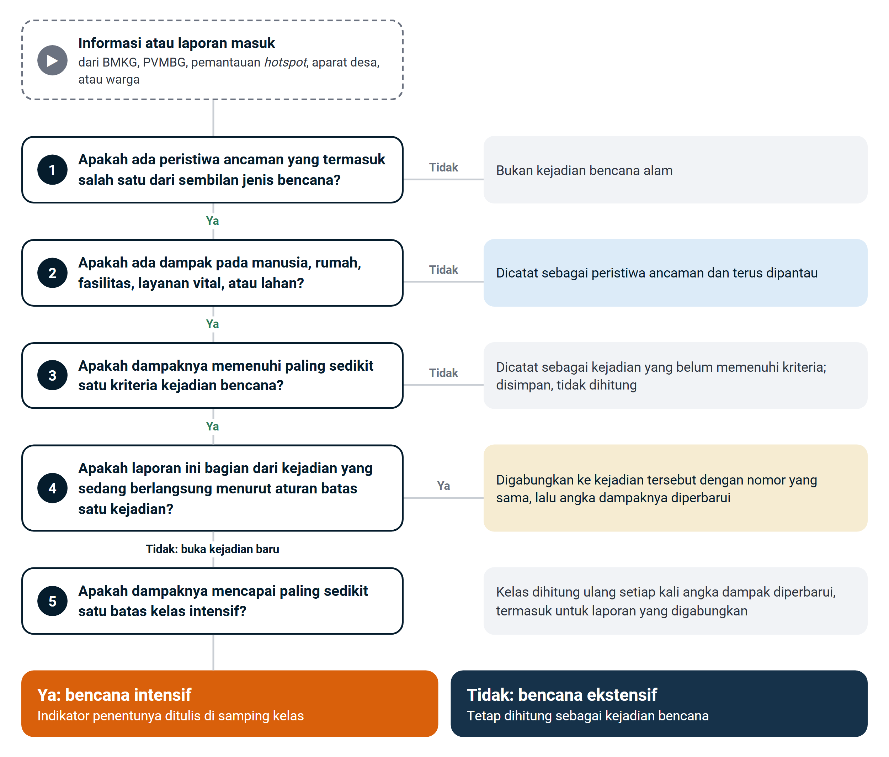
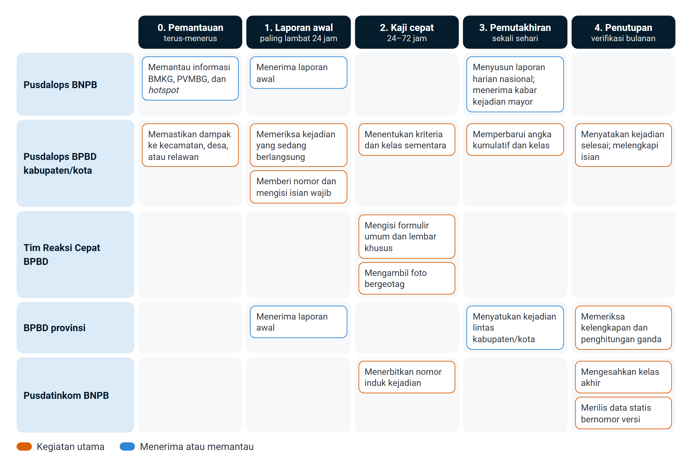

# BAB I | PENDAHULUAN

## A. LATAR BELAKANG

Data kejadian dan dampak bencana merupakan dasar bagi pengambilan keputusan pada saat keadaan darurat, perencanaan pengurangan risiko bencana, penyusunan anggaran, rehabilitasi dan rekonstruksi pascabencana, serta pelaporan capaian Kerangka Sendai untuk Pengurangan Risiko Bencana 2015–2030. Data tersebut hanya dapat dipakai untuk keperluan itu apabila dikumpulkan dengan konsep, definisi, klasifikasi, ukuran, dan satuan yang sama di seluruh wilayah Indonesia.

Peraturan BNPB Nomor 1 Tahun 2023 tentang Satu Data Bencana menugaskan walidata bencana untuk menyiapkan kriteria kejadian bencana, jangka waktu pengumpulan data kejadian bencana, nomor induk setiap kejadian bencana, dan standar prosedur operasional Satu Data Bencana. Ketentuan tersebut telah dijabarkan dalam Petunjuk Pelaksanaan Standar Data Kejadian dan Dampak Bencana Nomor 7 Tahun 2023.

Telaah terhadap Petunjuk Pelaksanaan Nomor 7 Tahun 2023 menunjukkan bahwa kerangkanya sudah sesuai dengan prinsip Satu Data Indonesia dan praktik internasional. Namun, sebagian ketentuan yang menentukan angka kejadian dan dampak perlu diperjelas, sebagian perlu dirumuskan ulang, dan beberapa hal penting belum diatur, antara lain batas waktu satu kejadian, identitas kejadian lintas wilayah, kelas kejadian menurut besarnya dampak, data khusus untuk setiap jenis bencana, dan pelindungan data pribadi.

Mempertimbangkan uraian di atas, perlu ditetapkan petunjuk pelaksanaan standar data kejadian dan dampak bencana yang menggantikan Petunjuk Pelaksanaan Nomor 7 Tahun 2023, dengan tetap mempertahankan kerangka, jenis bencana beserta kodenya, struktur Kode Identitas Bencana, dan angka kriteria kejadian bencana yang telah berlaku.

## B. MAKSUD DAN TUJUAN

Petunjuk pelaksanaan ini dimaksudkan sebagai panduan bagi BNPB, BPBD provinsi, BPBD kabupaten/kota, kementerian/lembaga, dan pemangku kepentingan lainnya dalam mengumpulkan, mengolah, memverifikasi, dan menyajikan data kejadian dan dampak bencana.

Petunjuk pelaksanaan ini disusun dengan tujuan:

1. terstandarnya data kejadian dan dampak bencana di seluruh wilayah Indonesia;
2. terwujudnya cara yang sama dalam menentukan kejadian bencana, batas satu kejadian, dan kelas kejadian;
3. tercapainya interoperabilitas data kejadian dan dampak bencana antara BNPB, BPBD, kementerian/lembaga, dan pemangku kepentingan lainnya; dan
4. terjaganya mutu, keterlacakan, dan pelindungan data kejadian dan dampak bencana.

## C. RUANG LINGKUP

Ruang lingkup petunjuk pelaksanaan ini meliputi:

1. pengertian;
2. standar data kejadian dan dampak bencana, yang terdiri atas jenis bencana dan kodenya, identitas kejadian, kriteria kejadian bencana, batas satu kejadian, metode penghitungan, kelas kejadian, dan daftar data; dan
3. pengelolaan data, yang terdiri atas pengorganisasian, tahapan pengumpulan data, pengolahan dan verifikasi, data statis dan rilis data, analisis dan penyajian, serta pelindungan data pribadi.

## D. PENGERTIAN

Dalam petunjuk pelaksanaan ini yang dimaksud dengan:

1. Data adalah catatan atas kumpulan fakta atau deskripsi berupa angka, karakter, simbol, gambar, peta, tanda, isyarat, tulisan, suara, dan/atau bunyi, yang merepresentasikan keadaan sebenarnya atau menunjukkan suatu ide, objek, kondisi, atau situasi.
2. Bencana adalah peristiwa atau rangkaian peristiwa yang mengancam dan mengganggu kehidupan dan penghidupan masyarakat yang disebabkan, baik oleh faktor alam dan/atau faktor nonalam maupun faktor manusia sehingga mengakibatkan timbulnya korban jiwa manusia, kerusakan lingkungan, kerugian harta benda, dan dampak psikologis.
3. Data Bencana adalah data mengenai bencana yang sesuai dengan kriteria yang ditetapkan oleh walidata bencana.
4. Standar Data adalah standar yang mendasari data tertentu yang terdiri atas konsep, definisi, klasifikasi, ukuran, dan satuan.
5. Konsep adalah ide yang mendasari data dan tujuan data tersebut diproduksi.
6. Definisi adalah penjelasan tentang data yang memberi batas atau membedakan secara jelas arti dan cakupan data tertentu dengan data yang lain.
7. Klasifikasi adalah penggolongan data secara sistematis ke dalam kelompok atau kategori berdasarkan kriteria yang ditetapkan oleh pembina data atau dibakukan secara luas.
8. Ukuran adalah unit yang digunakan dalam pengukuran jumlah, kadar, atau cakupan.
9. Satuan adalah besaran tertentu dalam data yang digunakan sebagai standar untuk mengukur atau menakar sebagai sebuah keseluruhan.
10. Kode Referensi adalah tanda berisi karakter yang mengandung atau menggambarkan makna, maksud, atau norma tertentu sebagai rujukan identitas data yang bersifat unik.
11. Peristiwa Ancaman adalah kejadian atau peristiwa alam, nonalam, atau sosial yang bisa menimbulkan bencana dan sudah terdeteksi atau dilaporkan pada tempat dan waktu tertentu, tetapi belum tentu menimbulkan dampak.
12. Kejadian Bencana adalah peristiwa ancaman yang menimbulkan dampak dan memenuhi paling sedikit satu kriteria kejadian bencana, atau, untuk bencana nonalam dan bencana sosial, yang telah ditetapkan oleh otoritas sektor sebagaimana dimaksud dalam Bab II huruf C angka 9.
13. Dampak adalah akibat kejadian bencana pada manusia, rumah, fasilitas publik, jalan dan jembatan, layanan vital, lahan, tambak, atau ternak.
14. Kejadian yang Belum Memenuhi Kriteria adalah peristiwa ancaman yang menimbulkan dampak, tetapi belum memenuhi satu pun kriteria kejadian bencana.
15. Kejadian Pemicu adalah kejadian atau peristiwa ancaman yang memicu kejadian bencana lain dalam satu rangkaian.
16. Kejadian Terpicu adalah kejadian bencana yang dipicu oleh kejadian pemicu, misalnya tsunami atau tanah longsor yang dipicu oleh gempa bumi.
17. Catatan Kabupaten/Kota adalah catatan satu kejadian pada satu kabupaten/kota yang terdampak, termasuk catatan yang belum diketahui memenuhi kriteria kejadian bencana.
18. Kode Identitas Bencana yang selanjutnya disingkat KIB adalah kode referensi berupa kode unik 16 digit untuk setiap catatan kabupaten/kota.
19. Nomor Induk Kejadian adalah nomor unik yang diterbitkan walidata bencana untuk satu kejadian bencana di tingkat nasional dan dipakai oleh semua catatan kabupaten/kota yang termasuk dalam kejadian tersebut.
20. Korban Meninggal adalah orang yang meninggal dunia pada saat kejadian bencana atau karena luka yang dideritanya pada saat kejadian tersebut, misalnya tertimbun, tenggelam, terseret arus, tertimpa bangunan, atau terbakar.
21. Kematian Tidak Langsung adalah kematian yang timbul dari keadaan sesudah kejadian bencana, misalnya karena penyakit di pengungsian.
22. Korban Hilang adalah orang yang tidak ditemukan atau tidak diketahui keberadaannya setelah kejadian bencana.
23. Korban Luka Berat adalah orang yang mengalami luka atau sakit karena kejadian bencana dan memerlukan rawat inap.
24. Korban Luka Ringan adalah orang yang mengalami luka atau sakit karena kejadian bencana dan cukup memperoleh rawat jalan.
25. Pengungsi adalah orang atau kelompok orang yang terpaksa atau dipaksa keluar dari tempat tinggalnya untuk jangka waktu yang belum pasti sebagai akibat dampak buruk bencana, termasuk orang yang dievakuasi sebelum dampak terjadi.
26. Terdampak adalah orang yang menderita akibat dampak buruk bencana, seperti kerusakan atau kerugian harta benda atau hilangnya sumber penghidupan, tetapi masih dapat menempati tempat tinggalnya. Untuk kekeringan, terdampak adalah orang yang membutuhkan bantuan air bersih.
27. Terancam adalah orang yang berada di wilayah yang terancam tetapi belum terkena dampak.
28. Rumah adalah bangunan yang dihuni sebagai tempat tinggal.
29. Rumah Rusak Berat adalah rumah yang roboh, hanyut, terbakar habis, atau tertimbun material setinggi 1 meter atau lebih di atas lantai, atau rumah yang tingkat kerusakan fisiknya lebih dari 70 persen.
30. Rumah Rusak Sedang adalah rumah yang tingkat kerusakan fisiknya 30 sampai 70 persen dan bangunannya masih berdiri.
31. Rumah Rusak Ringan adalah rumah yang tingkat kerusakan fisiknya kurang dari 30 persen, strukturnya masih dapat digunakan, dan bangunannya masih berdiri.
32. Rumah Terendam adalah rumah yang tergenang air tanpa kerusakan pada komponen struktur dan tidak termasuk rumah tidak dapat dihuni sementara.
33. Rumah Tidak Dapat Dihuni Sementara adalah rumah yang tidak rusak berat maupun rusak sedang, tetapi tergenang air paling sedikit 10 sentimeter di atas lantai atau tertutup lumpur dan material sehingga untuk sementara tidak dapat dihuni, termasuk rumah rusak ringan yang berada dalam keadaan tersebut.
34. Rumah Rusak Berat Terbobot adalah jumlah rumah rusak berat ditambah setengah jumlah rumah rusak sedang dan sepertiga jumlah rumah tidak dapat dihuni sementara.
35. Fasilitas Publik adalah bangunan satuan pendidikan, fasilitas pelayanan kesehatan, rumah ibadat, kantor pemerintah, dan pasar.
36. Layanan Vital adalah layanan listrik, air bersih, telekomunikasi, bahan bakar, sarana transportasi umum, rumah sakit rujukan, serta jalan dan jembatan utama.
37. Puso adalah keadaan tanaman yang rusak sangat berat sehingga gagal panen.
38. Luas Terbakar Terverifikasi adalah luas area yang terbakar menurut pengukuran lapangan atau citra satelit resolusi tinggi, bukan menurut jumlah *hotspot*, yaitu piksel citra satelit yang suhunya jauh lebih tinggi daripada sekitarnya.
39. Kerusakan adalah perubahan bentuk pada aset fisik dan infrastruktur sehingga fungsinya terganggu sebagian atau seluruhnya sebagai akibat langsung kejadian bencana.
40. Kerugian adalah meningkatnya biaya atau hilangnya kesempatan memperoleh pendapatan karena kerusakan aset sebagai akibat tidak langsung kejadian bencana.
41. Data Dinamis adalah data kejadian bencana yang bersifat sementara dan masih berubah sesuai dengan laporan perkembangan selama kejadian berlangsung.
42. Data Statis adalah data kejadian bencana yang sudah diverifikasi dan tidak berubah lagi, kecuali melalui koreksi yang dicatat sebagai versi baru.
43. Nihil adalah keadaan isian yang nilainya nol dan sudah dipastikan melalui pendataan.
44. Belum Didata adalah keadaan isian yang nilainya belum diketahui.
45. Bencana Intensif adalah kejadian bencana yang dampaknya mencapai paling sedikit satu batas indikator umum atau indikator khusus dalam Tabel 3.
46. Bencana Ekstensif adalah kejadian bencana yang tidak mencapai satu pun batas dalam Tabel 3.
47. Produsen Data Bencana adalah unit kerja yang menghasilkan data bencana berdasarkan tugas dan fungsinya.
48. Walidata Bencana adalah unit kerja yang melaksanakan kegiatan pengumpulan, pemeriksaan, dan pengelolaan data yang disampaikan oleh produsen data bencana, serta menyebarluaskan data.
49. *Rapid Assessment* adalah pengkajian cepat sebagaimana dimaksud dalam Petunjuk Pelaksanaan BNPB Nomor 3 Tahun 2022 tentang Pengkajian Cepat.
50. Status Keadaan Tertentu adalah status yang ditetapkan sebagaimana dimaksud dalam Peraturan Presiden Nomor 17 Tahun 2018 tentang Penyelenggaraan Penanggulangan Bencana dalam Keadaan Tertentu.
51. Relokasi adalah pemindahan penduduk secara tetap dari lokasi yang tidak dapat dihuni lagi karena kejadian bencana atau ancaman lanjutannya.
52. Tanaman Rusak Berat adalah tanaman yang menurut laporan dinas yang membidangi pertanian tergolong terkena dengan intensitas berat, tetapi belum puso.
53. Hari yang Sama adalah tanggal kalender menurut waktu setempat di kabupaten/kota tersebut.

# BAB II | STANDAR DATA KEJADIAN DAN DAMPAK BENCANA

## A. JENIS BENCANA DAN KODE

1. Jenis bencana dikelompokkan menjadi tiga kelompok, yaitu bencana alam, bencana nonalam, dan bencana sosial, serta 13 jenis sebagaimana tercantum dalam Tabel 1.
2. Setiap jenis bencana memiliki subjenis. Satu kejadian hanya memiliki satu subjenis untuk setiap jenis bencana. Apabila beberapa subjenis terjadi bersamaan, misalnya awan panas dan hujan abu dalam satu episode erupsi, dipilih subjenis yang menimbulkan dampak terbesar, dan subjenis lainnya dicatat dalam lembar data khusus.
3. Gabungan beberapa jenis bencana dalam satu rangkaian tidak dicatat sebagai subjenis, tetapi sebagai kejadian pemicu dan kejadian terpicu.

Tabel 1. Jenis bencana, kode, dan subjenis

| Kelompok | Jenis bencana | Kode | Subjenis |
| --- | --- | ---: | --- |
| Bencana alam | Banjir | 101 | Banjir luapan sungai; banjir genangan; banjir bandang; banjir rob; banjir lahar; banjir akibat jebolnya tanggul, waduk, atau bendungan |
| | Tanah longsor | 102 | Longsoran; jatuhan batuan; aliran bahan rombakan; gerakan tanah lambat |
| | Gelombang pasang dan abrasi | 103 | Gelombang pasang; abrasi pantai |
| | Cuaca ekstrem | 104 | Puting beliung; angin kencang; siklon tropis; hujan es; suhu udara ekstrem |
| | Kekeringan | 105 | Kekeringan meteorologis; kekeringan pertanian; kekeringan hidrologis |
| | Kebakaran hutan dan lahan | 106 | Kebakaran hutan; kebakaran lahan bukan gambut; kebakaran lahan gambut |
| | Gempa bumi | 107 | Gempa tektonik; gempa vulkanik; gempa runtuhan |
| | Tsunami | 108 | Tsunami seismik; tsunami nonseismik |
| | Erupsi gunung api | 109 | Awan panas guguran; awan panas letusan; hujan abu; gas vulkanik beracun; lontaran material pijar |
| Bencana nonalam | Epidemi dan wabah penyakit | 201 | Wabah penyakit; epidemi |
| | Kebakaran gedung dan permukiman | 202 | Kebakaran gedung; kebakaran permukiman |
| | Gagal teknologi | 203 | Kegagalan industri; kecelakaan industri |
| Bencana sosial | Konflik sosial | 301 | Konflik sosial; teror; kerusuhan sosial |

4. Jarak sumber tsunami dicatat sebagai atribut tersendiri dengan isian lokal, regional, atau jarak jauh, sesuai dengan informasi BMKG.

## B. IDENTITAS KEJADIAN

1. Setiap catatan kabupaten/kota diberi KIB sejak laporan awal, termasuk catatan yang belum diketahui memenuhi kriteria kejadian bencana. KIB terdiri atas 16 digit dengan susunan:
   a. 2 angka kode provinsi;
   b. 2 angka kode kabupaten/kota;
   c. 3 angka kode jenis bencana;
   d. 8 angka tanggal mulai kejadian di kabupaten/kota tersebut dengan format tahun, bulan, dan tanggal; dan
   e. 1 angka indeks urutan kejadian sejenis yang dimulai pada hari yang sama di kabupaten/kota tersebut, dimulai dari angka 1. Indeks lebih dari 1 dipakai untuk kejadian baru sebagaimana dimaksud dalam huruf D angka 1 huruf d dan untuk kejadian yang dipisahkan oleh walidata bencana.
2. Kode provinsi dan kode kabupaten/kota mengikuti kode wilayah yang ditetapkan oleh kementerian yang menyelenggarakan urusan pemerintahan dalam negeri.
3. Apabila satu kejadian bencana berdampak pada beberapa kabupaten/kota, setiap kabupaten/kota memakai kode wilayahnya sendiri dalam KIB.
4. Apabila titik kejadian berada di laut, kode wilayah mengikuti kabupaten/kota terdampak yang terdekat dari titik tersebut.
5. Setiap kejadian diberi nomor induk kejadian oleh walidata bencana paling lambat 72 jam setelah kejadian diketahui, bersamaan dengan hasil awal *rapid assessment*. Nomor induk kejadian terdiri atas 3 angka kode jenis bencana, 4 angka tahun tanggal mulai kejadian, dan 6 angka nomor urut, misalnya 107-2026-000015. Nomor induk kejadian hanya diterbitkan untuk kejadian bencana. Sebelum nomor induk terbit, Pusat Pengendalian Operasi BNPB menautkan sementara catatan kabupaten/kota yang berasal dari satu peristiwa.
6. Semua KIB dari satu kejadian bencana ditautkan dengan nomor induk kejadian yang sama.
7. Kejadian terpicu diberi nomor induk kejadian sendiri dan ditautkan dengan nomor induk kejadian pemicunya.
8. Untuk keperluan pertukaran data internasional, kejadian bencana intensif dapat diberi nomor GLIDE (*GLobal IDEntifier number*), yaitu nomor identitas bencana internasional yang dikelola Asian Disaster Reduction Center, yang diajukan oleh walidata bencana.

## C. KRITERIA KEJADIAN BENCANA

1. Suatu peristiwa dicatat sebagai kejadian bencana apabila penyebabnya termasuk salah satu jenis bencana dalam Tabel 1 dan memenuhi paling sedikit satu dari kriteria berikut:
   a. 1 orang meninggal atau hilang;
   b. 50 orang terdampak, luka, atau mengungsi;
   c. 5 unit rumah, fasilitas publik, dan/atau jembatan rusak;
   d. 1 hektare luas terbakar terverifikasi untuk kebakaran hutan dan lahan, atau 1 hektare sawah atau kebun puso untuk jenis bencana lainnya;
   e. permintaan pemerintah daerah untuk diberikan bantuan nasional; atau
   f. penetapan status keadaan darurat bencana atau status keadaan tertentu.
2. Kriteria sebagaimana dimaksud pada angka 1 diukur dengan ketentuan:
   a. korban meninggal dan korban hilang dijumlahkan;
   b. orang terdampak, luka, dan mengungsi dijumlahkan, setiap orang hanya dihitung satu kali, dan pengungsi yang dievakuasi sebelum dampak terjadi ikut dihitung;
   c. jumlah rumah, fasilitas publik, dan jembatan yang rusak dijumlahkan untuk rusak berat, rusak sedang, tidak dapat dihuni sementara, dan rusak ringan; jumlah setiap tingkat dicatat terpisah; rumah terendam dan jalan tidak dihitung dalam kriteria ini;
   d. luas terbakar dicatat dengan sumber pengukuran lapangan atau citra satelit resolusi tinggi, dan luas puso dicatat dengan sumber data dinas yang membidangi pertanian;
   e. permintaan bantuan nasional dibuktikan dengan surat yang bernomor, bertanggal, dan menyebut kejadian tersebut; dan
   f. penetapan status dibuktikan dengan surat keputusan yang mencakup jenis bencana, wilayah, dan periode kejadian tersebut, dan kejadian tersebut menimbulkan dampak yang tercatat.
3. Kriteria diterapkan pada setiap catatan kabupaten/kota dan pada kejadian di tingkat nasional, dengan memakai angka kumulatif setelah laporan digabungkan menurut huruf D dan dihitung menurut huruf E. Kejadian lintas kabupaten/kota yang baru memenuhi kriteria apabila dampaknya dijumlahkan dicatat sebagai kejadian bencana di tingkat nasional. Catatan kabupaten/kota yang tidak memenuhi kriteria secara sendiri tetap dicatat sebagai bagian dari kejadian nasional tersebut, tetapi tidak dihitung dalam jumlah kejadian bencana kabupaten/kota.
4. Kejadian yang belum memenuhi kriteria tetap dicatat dan disimpan, tetapi tidak dihitung dalam jumlah kejadian bencana. Pemenuhan kriteria diperiksa ulang setiap kali angka dampak diperbarui.
5. Peristiwa ancaman dinyatakan menimbulkan dampak apabila paling sedikit satu isian berikut bernilai lebih dari nol atau, untuk layanan vital, berstatus selain normal:
   a. manusia: korban meninggal, korban hilang, korban luka berat, korban luka ringan, pengungsi termasuk orang yang dievakuasi sebelum dampak terjadi, atau terdampak;
   b. rumah: rumah rusak berat, rusak sedang, tidak dapat dihuni sementara, rusak ringan, atau terendam;
   c. fasilitas publik, jalan, atau jembatan yang rusak, dengan jalan diukur dalam kilometer;
   d. layanan vital yang terganggu; atau
   e. lahan, tambak, dan ternak: luas terbakar, sawah atau kebun yang terendam atau puso, tambak yang rusak, atau ternak yang mati.
   Isian lain, seperti kematian tidak langsung, jaringan irigasi, usaha, dan nilai kerusakan, dicatat tetapi tidak menentukan adanya dampak.
6. Orang terancam tidak dihitung sebagai dampak.
7. Satu isian dampak yang bernilai lebih dari nol sudah cukup untuk menyatakan adanya dampak, walaupun isian dampak lainnya belum didata. Apabila belum ada isian dampak yang bernilai lebih dari nol, tetapi masih ada isian dampak yang berstatus belum didata, peristiwa ancaman dicatat dengan keterangan menunggu data. Peristiwa ancaman dinyatakan tidak menimbulkan dampak apabila semua isian dampak berstatus nihil.
8. Peristiwa ancaman yang tidak menimbulkan dampak dicatat dalam catatan pemantauan dan tidak dilaporkan sebagai kejadian bencana.
9. Untuk bencana nonalam dan bencana sosial, suatu peristiwa dicatat sebagai kejadian bencana apabila memenuhi kriteria sebagaimana dimaksud pada angka 1 atau apabila otoritas sektor telah menetapkannya, yaitu penetapan kejadian luar biasa atau wabah oleh otoritas kesehatan untuk epidemi dan wabah penyakit, laporan kejadian oleh dinas pemadam kebakaran untuk kebakaran gedung dan permukiman, dan penetapan status keadaan konflik oleh pemerintah untuk konflik sosial. Untuk gagal teknologi berlaku kriteria sebagaimana dimaksud pada angka 1. Dampaknya dicatat menurut Lampiran I.

## D. BATAS SATU KEJADIAN

1. Batas satu kejadian ditentukan dengan ketentuan umum sebagai berikut, sepanjang Tabel 2 tidak mengatur lain:
   a. kejadian yang berdampak pada beberapa kabupaten/kota dihitung sebagai satu kejadian di tingkat nasional dan satu kejadian di setiap kabupaten/kota terdampak yang memenuhi kriteria kejadian bencana;
   b. kejadian sejenis di beberapa lokasi dalam satu kabupaten/kota pada hari yang sama dihitung sebagai satu kejadian;
   c. kejadian dinyatakan selesai oleh BPBD kabupaten/kota apabila dampak fisiknya sudah berhenti;
   d. peristiwa ancaman baru yang menimbulkan dampak setelah kejadian dinyatakan selesai dicatat sebagai kejadian baru; dan
   e. kejadian terpicu dicatat terpisah dan ditautkan dengan kejadian pemicunya.
2. Ketentuan khusus untuk setiap jenis bencana alam tercantum dalam Tabel 2. Satuan dalam Tabel 2 adalah catatan kabupaten/kota, kecuali disebut lain.
3. Peringatan tsunami yang tidak diikuti genangan air laut di daratan tidak dicatat sebagai kejadian bencana tsunami. Orang yang mengungsi karena peringatan tersebut dicatat sebagai pengungsi pada kejadian pemicunya di kabupaten/kota tersebut. Apabila kejadian pemicu tidak tercatat di kabupaten/kota tersebut, pengungsian dicatat dalam catatan pemantauan peristiwa ancaman tsunami.

Tabel 2. Batas satu kejadian untuk setiap jenis bencana alam

| Jenis bencana | Satu kejadian | Kejadian selesai apabila |
| --- | --- | --- |
| Banjir | Satu episode genangan di satu kabupaten/kota yang berasal dari hujan atau pasang air laut yang sama | Genangan dinyatakan surut oleh BPBD di semua desa terdampak; genangan karena hujan berikutnya yang timbul sesudah genangan surut dicatat sebagai kejadian baru |
| Tanah longsor | Semua titik longsor dalam satu kabupaten/kota pada hari yang sama; jumlah titik dicatat | Pencarian korban dihentikan dan akses utama dibuka kembali |
| Gelombang pasang dan abrasi | Gelombang pasang dicatat per episode; abrasi dicatat per kabupaten/kota per tahun kalender | Laut kembali tenang menurut BMKG; abrasi ditutup pada akhir tahun kalender |
| Cuaca ekstrem | Satu lintasan puting beliung, atau semua titik kerusakan akibat angin dalam satu kabupaten/kota pada hari yang sama; untuk siklon tropis dan suhu udara ekstrem, satu episode selama peringatan BMKG berlaku | Cuaca kembali normal menurut BMKG; untuk siklon tropis dan suhu udara ekstrem, BMKG mengakhiri peringatan |
| Kekeringan | Satu kabupaten/kota dalam satu musim kemarau menurut zona musim BMKG | Musim hujan dimulai menurut BMKG atau bantuan air bersih dihentikan |
| Kebakaran hutan dan lahan | Area terbakar yang saling bersinggungan, dengan selisih waktu antarkebakaran paling lama 5 hari | Api dinyatakan padam oleh tim lapangan dan tidak terdeteksi *hotspot* baru di area tersebut selama 5 hari |
| Gempa bumi | Satu gempa utama; gempa susulan yang menimbulkan kerusakan baru selama masa tanggap darurat gempa utama termasuk kejadian yang sama; gempa yang sama besar atau lebih besar daripada gempa utama, atau berpusat di luar daerah sebaran gempa susulan menurut BMKG, dicatat sebagai kejadian baru | Masa tanggap darurat berakhir; apabila tidak ada penetapan status, berlaku angka 1 huruf c |
| Tsunami | Satu rangkaian gelombang tsunami dari satu sumber; dicatat sebagai kejadian terpicu apabila pemicunya tercatat; peringatan tanpa genangan diatur dalam angka 3 | BMKG mengakhiri peringatan dan pencarian korban di kawasan genangan dihentikan |
| Erupsi gunung api | Satu episode erupsi sejak erupsi pertama yang berdampak | Tingkat aktivitas gunung api diturunkan ke Level II (Waspada) atau lebih rendah; banjir lahar dicatat sebagai kejadian banjir yang ditautkan dengan erupsi sumbernya |

## E. METODE PENGHITUNGAN

1. Jumlah kejadian bencana di tingkat nasional dihitung berdasarkan nomor induk kejadian. Jumlah kejadian di tingkat provinsi dihitung satu kali untuk setiap kejadian bencana yang mempunyai paling sedikit satu catatan kabupaten/kota di provinsi tersebut, dan jumlah kejadian di tingkat kabupaten/kota dihitung berdasarkan KIB yang memenuhi kriteria.
2. Korban dan kerusakan dicatat satu kali pada kejadian yang secara langsung menyebabkannya. Jumlah dampak suatu rangkaian kejadian dihitung dengan menjumlahkan kejadian pemicu dan kejadian terpicunya untuk keperluan penyajian, dan tidak menentukan kriteria maupun kelas setiap kejadian.
3. Setiap orang dicatat pada satu kategori saja dengan urutan prioritas meninggal, hilang, luka berat, luka ringan, mengungsi, lalu terdampak.
4. Selama kejadian berlangsung, angka korban meninggal, korban hilang, dan kerusakan memakai angka terakhir, sedangkan angka korban luka, terdampak, dan pengungsi memakai angka terbanyak selama kejadian. Untuk kriteria sebagaimana dimaksud dalam huruf C angka 1 huruf b, angka korban luka, terdampak, dan pengungsi yang dijumlahkan diambil dari laporan yang sama, yaitu laporan dengan jumlah ketiganya terbanyak, agar setiap orang hanya dihitung satu kali.
5. Angka dari laporan harian yang berbeda tidak dijumlahkan, karena setiap laporan memuat keadaan kumulatif.
6. Korban hilang yang kemudian ditemukan meninggal dipindahkan ke kategori meninggal. Korban hilang yang ditemukan selamat dikeluarkan dari kategori hilang, dan alasan penurunan angka dicatat.
7. Kematian tidak langsung dicatat terpisah dan tidak dihitung dalam kriteria maupun kelas kejadian.
8. Kejadian yang berlangsung melewati akhir tahun dicatat pada tahun tanggal mulai kejadian.

## F. KELAS KEJADIAN

1. Kejadian bencana digolongkan ke dalam dua kelas, yaitu bencana intensif dan bencana ekstensif.
2. Kejadian bencana tergolong bencana intensif apabila mencapai paling sedikit satu batas dalam Tabel 3, baik batas indikator umum yang berlaku untuk semua jenis bencana maupun batas indikator khusus untuk jenis bencana yang bersangkutan. Kejadian bencana lainnya tergolong bencana ekstensif.

Tabel 3. Batas kelas bencana intensif

| No | Kelompok | Jenis bencana | Indikator | Batas |
| ---: | --- | --- | --- | --- |
| 1 | Umum | Semua jenis | Korban meninggal dan korban hilang, dijumlahkan | 30 orang atau lebih |
| 2 | Umum | Semua jenis | Rumah rusak berat terbobot | 600 unit atau lebih |
| 3 | Khusus | Tanah longsor | Pengungsi karena longsor, termasuk orang yang dievakuasi sebelum longsor terjadi dan orang yang direlokasi; setiap orang dihitung satu kali | 1.000 orang atau lebih |
| 4 | Khusus | Kekeringan | Penduduk yang kesulitan air minum karena kekeringan, yang merupakan bagian dari terdampak kekeringan, yaitu memakai air kurang dari 20 liter per orang per hari atau harus mengambil air jauh lebih jauh daripada biasanya selama lebih dari 15 hari, dibandingkan dengan penduduk kabupaten/kota | 15 persen atau lebih |
| 5 | Khusus | Kekeringan | Luas tanaman pangan yang puso atau rusak berat dibandingkan dengan luas tanam pada musim tanam tersebut di kabupaten/kota | lebih dari 50 persen |
| 6 | Khusus | Kebakaran hutan dan lahan | Luas terbakar terverifikasi pada hutan dan lahan selain savana, semak, dan padang rumput dalam satu kejadian | 1.000 hektare atau lebih |
| 7 | Khusus | Kebakaran hutan dan lahan | Luas terbakar terverifikasi pada savana, semak, dan padang rumput dalam satu kejadian | 8.000 hektare atau lebih |

3. Kelas ditetapkan untuk setiap catatan kabupaten/kota dan untuk kejadian di tingkat nasional. Kejadian di tingkat nasional tergolong bencana intensif apabila jumlah dampak di semua kabupaten/kota yang terdampak mencapai salah satu batas nomor 1, 2, 3, 6, atau 7 dalam Tabel 3, atau apabila salah satu catatan kabupaten/kotanya tergolong bencana intensif. Batas nomor 4 dan 5 hanya diterapkan pada catatan kabupaten/kota.
4. Untuk kebakaran hutan dan lahan, luas terbakar pada setiap kelompok tutupan dalam nomor 6 dan 7 Tabel 3 dinilai terpisah. Jumlah hari dengan Indeks Standar Pencemar Udara kategori berbahaya dicatat sebagai keterangan dan tidak menentukan kelas.
5. Indikator yang menentukan kelas dicatat di samping kelas.
6. Kelas dihitung ulang setiap kali angka dampak diperbarui. Kelas akhir ditetapkan oleh walidata bencana tingkat pusat setelah data diverifikasi.
7. Kelas kejadian merupakan klasifikasi data dan tidak menggantikan penetapan status keadaan darurat maupun penetapan tingkat bencana sebagaimana dimaksud dalam peraturan perundang-undangan.
8. Status keadaan darurat dicatat sebagai keterangan di samping kelas dan tidak menentukan kelas.
9. Batas dalam Tabel 3 ditinjau kembali oleh walidata bencana paling lambat satu tahun setelah petunjuk pelaksanaan ini berlaku.

## G. DAFTAR DATA

1. Data kejadian dan dampak bencana terdiri atas data umum dan data khusus.
2. Data umum berlaku untuk semua jenis bencana dan terdiri atas sepuluh kelompok, yaitu:
   a. identitas kejadian;
   b. waktu;
   c. lokasi;
   d. korban;
   e. pengungsian;
   f. kerusakan;
   g. layanan vital;
   h. lahan dan ekonomi;
   i. kebutuhan dan penanganan; dan
   j. mutu data.
3. Data khusus menjelaskan besarnya ancaman dan ancaman lanjutan untuk setiap jenis bencana alam.
4. Setiap isian angka memiliki salah satu dari tiga keadaan, yaitu ada nilai, nihil, atau belum didata. Isian yang belum didata tidak boleh dibaca sebagai nol.
5. Korban dan pengungsi dipilah menurut jenis kelamin, kelompok umur, dan disabilitas. Kelompok umur terdiri atas anak (0–17 tahun), dewasa (18–59 tahun), dan lanjut usia (60 tahun ke atas). Disabilitas didata dengan pertanyaan singkat Washington Group, yaitu enam pertanyaan baku tentang kesulitan fungsional dalam melihat, mendengar, berjalan, mengingat, merawat diri, dan berkomunikasi.
6. Kerusakan dan kerugian dicatat sebagai dua angka terpisah dalam satuan juta rupiah, disertai tahun harga, dan dihitung dengan metode pengkajian kebutuhan pascabencana sebagaimana diatur dalam Peraturan Kepala BNPB Nomor 15 Tahun 2011 tentang Pedoman Pengkajian Kebutuhan Pascabencana.
7. Format data umum tercantum dalam Lampiran I, definisi dan standar data tercantum dalam Lampiran II, dan lembar data khusus tercantum dalam Lampiran III.

# BAB III | PENGELOLAAN DATA

## A. PENGORGANISASIAN

1. Penyelenggara standar data kejadian dan dampak bencana terdiri atas:
   a. tingkat pusat, yang meliputi produsen data bencana dan walidata bencana; dan
   b. tingkat daerah provinsi dan kabupaten/kota, yang meliputi produsen data bencana daerah dan walidata bencana daerah.
2. Produsen data bencana di pusat dilaksanakan oleh unit kerja di lingkungan BNPB yang menghasilkan data bencana sesuai dengan tugas dan fungsinya.
3. Walidata bencana di pusat dilaksanakan oleh Pusat Data, Informasi, dan Komunikasi Kebencanaan, yang selanjutnya disebut Pusdatinkom.
4. Produsen data bencana daerah dan walidata bencana daerah dilaksanakan sesuai dengan ketentuan peraturan perundang-undangan mengenai penyelenggaraan satu data di daerah dan kelembagaan di daerah.
5. Pembagian tugas dalam pengumpulan dan pengolahan data tercantum dalam Tabel 4.

Tabel 4. Pembagian tugas

| Pelaksana | Tugas |
| --- | --- |
| Pusat Pengendalian Operasi BPBD kabupaten/kota | Menerima laporan, membuat laporan awal, memberikan KIB, dan memutakhirkan data harian |
| Tim Reaksi Cepat BPBD | Melakukan *rapid assessment*, mengisi data umum dan lembar data khusus, serta mengambil dokumentasi |
| Perangkat daerah terkait | Menyediakan data sektor, antara lain kesehatan, pertanian, pekerjaan umum, dan sosial |
| BPBD kabupaten/kota | Memverifikasi data kabupaten/kota, menyatakan kejadian selesai, dan menyampaikan data penutupan |
| BPBD provinsi | Memeriksa kelengkapan data, menyatukan catatan lintas kabupaten/kota di provinsinya, dan memverifikasi data statis |
| Pusat Pengendalian Operasi BNPB | Memantau peristiwa ancaman, menerima laporan BPBD, menautkan sementara catatan kabupaten/kota yang berasal dari satu peristiwa, dan menyusun laporan harian nasional |
| Pusdatinkom | Menerbitkan nomor induk kejadian paling lambat 72 jam setelah kejadian diketahui, memutuskan penggabungan atau pemisahan kejadian, melakukan verifikasi akhir, menetapkan kelas akhir, dan merilis data statis |

## B. TAHAPAN PENGUMPULAN DATA

1. Pengumpulan data kejadian dan dampak bencana dilaksanakan dalam lima tahap sebagai berikut:
   a. pemantauan, yaitu pencatatan peristiwa ancaman dari informasi resmi dan laporan masyarakat, lalu pemastian ada atau tidaknya dampak, yang dilaksanakan secara terus-menerus;
   b. laporan awal, yaitu pencatatan identitas, waktu, lokasi, dan dampak sementara, yang disampaikan paling lambat 24 jam setelah kejadian diketahui;
   c. *rapid assessment*, yaitu pengisian data umum dan lembar data khusus, yang dimulai paling lambat 24 jam setelah informasi diterima sesuai dengan petunjuk pelaksanaan pengkajian cepat, dan hasil awalnya disampaikan paling lambat 72 jam setelah kejadian diketahui;
   d. pemutakhiran, yaitu pembaruan data dinamis paling sedikit satu kali sehari selama kejadian berlangsung atau sesuai dengan kesepakatan pos komando; dan
   e. penutupan, yaitu pernyataan selesainya kejadian, pelengkapan isian, dan verifikasi berjenjang, yang diselesaikan paling lambat pada verifikasi bulanan berikutnya.
2. Alur penentuan kejadian bencana tercantum dalam Gambar 1, dan alur kerja pengumpulan data menurut pelaksana tercantum dalam Gambar 2.

## C. PENGOLAHAN DAN VERIFIKASI

1. Pengolahan data dilaksanakan melalui kompilasi data, pembersihan data, dan verifikasi data.
2. Setiap angka mencantumkan sumber, waktu pendataan, dan status verifikasi. Status verifikasi terdiri atas terverifikasi dan belum terverifikasi.
3. Angka yang berasal dari pemberitaan atau media sosial dicatat dengan status belum terverifikasi sampai dikonfirmasi oleh produsen data bencana.
4. Verifikasi dilaksanakan secara berjenjang oleh BPBD kabupaten/kota, BPBD provinsi, dan walidata bencana dengan pemeriksaan sebagaimana tercantum dalam Tabel 5.

Tabel 5. Pemeriksaan mutu data

| No | Pemeriksaan |
| ---: | --- |
| 1 | Isian wajib terisi atau ditandai belum didata |
| 2 | Jumlah terpilah sama dengan jumlah total |
| 3 | Koordinat berada di dalam desa yang dipilih |
| 4 | Waktu kejadian tidak lebih lambat daripada waktu laporan |
| 5 | Setiap orang hanya tercatat pada satu kategori |
| 6 | Angka tidak dijumlahkan antarhari |
| 7 | Jumlah terdampak tidak melebihi jumlah penduduk wilayah |
| 8 | Kejadian terpicu ditautkan dengan kejadian pemicunya |
| 9 | Angka luas memiliki sumber yang jelas |
| 10 | Kerusakan utama memiliki dokumentasi yang memuat koordinat dan waktu pengambilan |

5. Walidata bencana dapat mengembalikan data kepada produsen data bencana untuk diperbaiki.

## D. DATA STATIS DAN RILIS DATA

1. Data dinamis berubah menjadi data statis setelah kejadian dinyatakan selesai dan data diverifikasi.
2. Walidata bencana memverifikasi data kejadian yang sudah selesai setiap bulan. Data yang sudah diverifikasi menjadi data statis, lalu dibekukan setiap triwulan, yaitu tidak dapat diubah kecuali melalui koreksi sebagai versi baru, dan dirilis setiap tahun oleh walidata bencana.
3. Setiap rilis data statis diberi nomor versi dan tanggal rilis.
4. Koreksi terhadap data statis yang sudah dirilis dicatat sebagai versi baru dan tidak menimpa versi sebelumnya. Perubahan angka antarversi dicatat beserta alasannya.

## E. ANALISIS, PENYAJIAN, DAN PENYEBARLUASAN

1. Analisis data kejadian dan dampak bencana dapat berupa analisis komposisi, analisis temporal, analisis statistik, dan analisis spasial.
2. Penyajian data mencantumkan nomor versi data, tanggal data, dan kelas kejadian apabila relevan.
3. Angka dari sumber yang berbeda tidak dijumlahkan dalam satu penyajian.
4. Penyebarluasan data dilaksanakan melalui portal Satu Data Bencana atau media lainnya sesuai dengan ketentuan peraturan perundang-undangan.

## F. PELINDUNGAN DATA PRIBADI

1. Rekapitulasi dan penyajian data hanya memuat jumlah yang sudah dipilah, tanpa nama orang.
2. Daftar nama korban meninggal, korban hilang, dan korban luka berat disimpan secara terbatas dan hanya dibuka oleh petugas yang berwenang untuk keperluan pencarian, identifikasi, layanan kesehatan, dan pemberian santunan.
3. Pelapor dicatat dengan jabatan dan instansinya. Nomor telepon pribadi pelapor tidak dimasukkan ke dalam rekapitulasi.
4. Pengelolaan data pribadi dilaksanakan sesuai dengan Undang-Undang Nomor 27 Tahun 2022 tentang Pelindungan Data Pribadi.

# BAB IV | PENUTUP

1. Petunjuk pelaksanaan ini mulai berlaku pada tanggal ditetapkan.
2. Pada saat petunjuk pelaksanaan ini mulai berlaku, Petunjuk Pelaksanaan Standar Data Kejadian dan Dampak Bencana Nomor 7 Tahun 2023 dicabut dan dinyatakan tidak berlaku.
3. Data kejadian bencana yang tercatat sebelum petunjuk pelaksanaan ini berlaku tetap berlaku sesuai dengan ketentuan pada saat data tersebut dicatat.
4. Kejadian bencana yang masih berlangsung pada saat petunjuk pelaksanaan ini mulai berlaku dicatat sesuai dengan petunjuk pelaksanaan ini sejak tanggal berlakunya. KIB yang sudah diberikan tetap dipakai, dan angka yang sudah tercatat menjadi angka awal yang diperbarui menurut Bab II huruf E angka 4.
5. Tahun mulai berlakunya petunjuk pelaksanaan ini dicatat dalam metadata data kejadian bencana sebagai titik perubahan metode.

::: ttd
