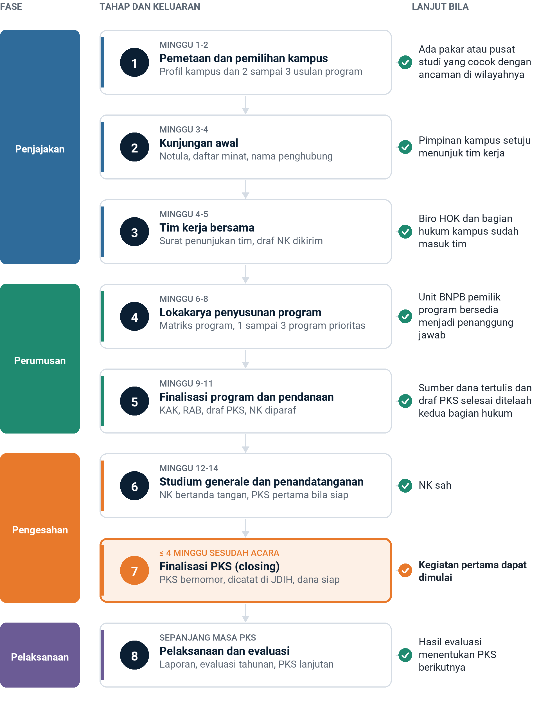

judul: Alur Kerja Sama BNPB dan Perguruan Tinggi sampai Finalisasi Perjanjian Kerja Sama
judul_pendek: Alur Kerja Sama BNPB dan Perguruan Tinggi sampai Finalisasi PKS
subjudul: Delapan tahap dari pemetaan kampus sampai PKS bertanda tangan, beserta dokumen, syarat closing, pendanaan, dan bahan diskusi dengan Biro Hukum, Organisasi, dan Kerja Sama
tanggal: 11 November 2026
foto: ~/.claude/skills/ppt-konsultan/bnpb/assets/proyek-flagship/foto/kampus-itb.jpg
kredit: Foto sampul: A2613, Wikimedia Commons, lisensi CC BY-SA 4.0.

# Ringkasan Eksekutif
Titik *closing* kerja sama dengan perguruan tinggi adalah Perjanjian Kerja Sama (PKS) yang sudah ditandatangani. PKS itu memuat tiga hal, yaitu kegiatan dengan keluaran yang terukur, sumber dana yang sudah tercantum dalam anggaran masing-masing pihak, dan penanggung jawab dari kedua pihak. Nota Kesepahaman (NK) dan *studium generale* belum merupakan *closing*, karena NK tidak mengikat dan tidak memuat uang.
Alur yang disarankan terdiri atas delapan tahap, dan setiap tahap memiliki syarat lanjut yang jelas. Dibandingkan dengan rancangan awal, ada empat perubahan pokok.
1. Tahap pemetaan dan pemilihan kampus ditambahkan sebagai tahap 1, sebelum kunjungan awal.
2. Pertemuan pendahuluan kedua dan ketiga digabung menjadi satu lokakarya penyusunan program yang menghasilkan keluaran tertulis.
3. Biro Hukum, Organisasi, dan Kerja Sama (Biro HOK) BNPB terlibat sejak tim kerja dibentuk, bukan menjelang *studium generale*, karena telaah naskah adalah langkah yang paling lama.
4. Draf PKS pertama sudah final saat *studium generale*, sehingga NK dan PKS dapat ditandatangani pada hari yang sama.
Dengan alur ini, satu kampus memerlukan sekitar 3 sampai 4 bulan dari kunjungan awal sampai PKS pertama ditandatangani, bila kegiatannya memakai anggaran yang sudah tersedia. Bila kegiatan memerlukan dana baru dari BNPB, pelaksanaannya mengikuti siklus anggaran dan paling cepat berjalan pada tahun anggaran berikutnya atau melalui revisi anggaran.

# 1. Alur Sekilas
Tahap 1 sampai 5 berlangsung sekitar 11 minggu. *Studium generale* jatuh pada minggu ke-12 sampai ke-14, dan PKS harus final paling lambat 4 minggu sesudahnya.

# 2. Rincian Alur yang Disarankan
Setiap tahap baru boleh dilanjutkan bila syarat lanjutnya terpenuhi. Bila syarat itu belum terpenuhi, tahap tersebut diulang, atau kerja sama dengan kampus itu ditunda. Waktu dihitung dalam minggu sejak tahap 1 dimulai.
%% 15,18,23,20,14,10
| Tahap | Tujuan | Keluaran | Syarat lanjut | Penanggung jawab | Minggu ke |
| --- | --- | --- | --- | --- | --- |
| 1. Pemetaan dan pemilihan kampus | BNPB memilih kampus dan menyiapkan tawaran yang spesifik. | Profil kampus berisi pakar kebencanaan, pusat studi, NK lama, dan ancaman utama di wilayahnya, ditambah 2 sampai 3 usulan program. | Kampus memiliki pakar atau pusat studi yang cocok dengan ancaman di wilayahnya. | Tenaga Ahli Kepala BNPB | 1 sampai 2 |
| 2. Kunjungan awal | BNPB menyampaikan maksudnya dan mendengar minat kampus. | Notula, daftar minat kampus, dan nama penghubung kampus | Pimpinan kampus setuju menunjuk tim kerja. | Tenaga Ahli Kepala BNPB dan wakil rektor bidang kerja sama | 3 sampai 4 |
| 3. Tim kerja bersama | Kedua pihak menetapkan pembagian tugas. | Surat penunjukan tim kedua pihak, kerangka acuan tim, jadwal kerja, dan grup komunikasi | Tim sudah lengkap, termasuk Biro HOK BNPB dan bagian hukum kampus, dan draf NK sudah dikirim. | Ketua tim kedua pihak | 4 sampai 5 |
| 4. Lokakarya penyusunan program | Tim mencocokkan masalah BNPB dengan keahlian kampus. | Matriks program, 1 sampai 3 program prioritas, dan catatan telaah draf NK | Program prioritas sudah disepakati, dan unit BNPB pemilik program bersedia menjadi penanggung jawab. | Tim kerja dan unit teknis BNPB | 6 sampai 8 |
| 5. Finalisasi program dan pendanaan, termasuk kunjungan teknis | Tim mengunci isi, biaya, dan sumber dana. | KAK dan RAB per program, surat kepastian sumber dana, draf PKS yang sudah ditelaah, dan naskah NK yang sudah diparaf | NK sudah diparaf, draf PKS sudah ditelaah kedua bagian hukum, dan sumber dana sudah tertulis. | Unit teknis BNPB, Biro HOK, dan bagian kerja sama kampus | 9 sampai 11 |
| 6. *Studium generale* dan penandatanganan | Kerja sama disahkan di depan publik. | NK bertanda tangan, dan PKS pertama bertanda tangan bila sudah siap | NK sudah sah. | Panitia gabungan sesuai Konsep Acara Studium Generale | 12 sampai 14 |
| 7. Finalisasi PKS (*closing*) | Program menjadi dapat dijalankan dan dibiayai. | PKS bertanda tangan, bernomor, dan tercatat di JDIH BNPB, ditambah kontrak swakelola atau kontrak pengadaan bila dana BNPB mengalir ke kampus | Kegiatan pertama dapat dimulai, dan dananya dapat dicairkan. | Pejabat penanda tangan PKS dan PPK | Paling lambat 4 minggu sesudah acara |
| 8. Pelaksanaan dan evaluasi | Kerja sama dijaga agar tetap berjalan. | Rencana kerja, laporan kemajuan, evaluasi tahunan sesuai pasal Evaluasi NK, laporan akhir, dan adendum bila perlu | Hasil evaluasi menentukan PKS lanjutan. | Penanggung jawab program kedua pihak | Sepanjang masa PKS |
KAK adalah Kerangka Acuan Kerja, dan RAB adalah rencana anggaran biaya. LPPM adalah Lembaga Penelitian dan Pengabdian kepada Masyarakat. JDIH adalah Jaringan Dokumentasi dan Informasi Hukum. PPK adalah Pejabat Pembuat Komitmen, yaitu pejabat yang menandatangani kontrak atas nama pemilik anggaran.
Bila NK lama masih berlaku, misalnya NK dengan UMY sampai 2029 dan NK dengan Unpad sampai 2031, tahap 1 sampai 5 dapat dipersingkat karena NK tidak perlu disusun ulang. Dalam keadaan itu, acara cukup menjadi penandatanganan PKS.

# 3. Dokumen yang Dibutuhkan per Tahap
Seluruh alur memerlukan 28 dokumen. Lima dokumen sudah tersedia dalam bentuk templat atau contoh, dan dua dokumen tersedia sebagian. Pekerjaan terbesar ada pada KAK, RAB, dan draf PKS untuk setiap program.
%% 9,17,22,16,18,18
| Tahap | Dokumen | Isi pokok | Penyusun | Pihak yang menyetujui atau menandatangani | Ketersediaan |
| --- | --- | --- | --- | --- | --- |
| 1 | Profil kampus | Pakar kebencanaan, pusat studi, NK lama, dan ancaman utama di wilayahnya | Tenaga Ahli Kepala BNPB | Dokumen ini tidak memerlukan persetujuan. | Sebagian tersedia dari direktori akademisi dan daftar pakar di bahan paparan kunjungan kampus. |
| 1 | Usulan program yang ditawarkan | Dua sampai tiga program dari Program Kemitraan BNPB dan Perguruan Tinggi | Tenaga Ahli Kepala BNPB | Dokumen ini tidak memerlukan persetujuan. | Tersedia dalam bahan paparan Ajuan Program Kerja Sama dan Program Flagship. |
| 2 | Surat permohonan audiensi | Maksud kunjungan, usulan waktu, dan susunan tim | Tenaga Ahli Kepala BNPB | Pejabat BNPB yang berwenang menandatangani surat yang ditujukan ke unit kerja sama kampus. | Tersedia melalui mesin surat dinas BNPB. |
| 2 | Bahan paparan kunjungan | Profil risiko wilayah, program yang ditawarkan, dan daftar pakar kampus | Tenaga Ahli Kepala BNPB | Dokumen ini tidak memerlukan persetujuan. | Tersedia mengikuti pola bahan paparan kunjungan kampus. |
| 2 | Notula dan daftar hadir | Minat kampus, nama penghubung, dan tindak lanjut | Kedua pihak | Ketua rombongan kedua pihak memarafnya. | Belum tersedia. |
| 3 | Surat penunjukan tim kerja | Nama, jabatan, dan peran anggota tim | Masing-masing pihak | Pejabat yang berwenang di masing-masing lembaga | Belum tersedia. |
| 3 | Kerangka acuan tim kerja | Tugas tim, jadwal, keluaran, dan cara rapat | Ketua tim kedua pihak | Kerangka acuan disepakati pada rapat pertama. | Belum tersedia. |
| 3 | Draf NK | Naskah NK dengan pola baku BNPB | Biro HOK BNPB | Bagian hukum kampus menelaahnya. | Tersedia sebagai Templat NK BNPB dan Perguruan Tinggi Koordinator. |
| 4 | Daftar masalah prioritas BNPB | Masalah per unit teknis BNPB yang dapat dibantu kampus | Tenaga Ahli Kepala BNPB bersama unit teknis | Pimpinan unit teknis | Belum tersedia. |
| 4 | Matriks program | Masalah BNPB, keahlian kampus, usulan kegiatan, dan keluaran | Tim kerja | Matriks disepakati dalam lokakarya. | Belum tersedia. |
| 4 | Notula lokakarya | Program prioritas, penanggung jawab, dan catatan atas draf NK | Sekretariat tim kerja | Ketua tim kedua pihak memarafnya. | Belum tersedia. |
| 5 | KAK per program | Latar, tujuan, kegiatan, keluaran, jadwal, dan penanggung jawab | Unit teknis BNPB bersama fakultas atau pusat studi | Pimpinan unit teknis dan pimpinan fakultas | Belum tersedia. |
| 5 | RAB per program | Rincian biaya per kegiatan dan pembagian beban | Unit teknis dan bagian keuangan kedua pihak | Pemilik anggaran masing-masing | Belum tersedia. |
| 5 | Surat kepastian sumber dana | Pernyataan bahwa kegiatan dibiayai dari anggaran tertentu | Bagian perencanaan dan keuangan masing-masing | Pejabat pemilik anggaran | Belum tersedia. |
| 5 | Draf PKS | Pasal hak, kewajiban, pembiayaan, hasil, kerahasiaan, dan pasal lain sesuai bagian 4 | Biro HOK BNPB dan bagian hukum kampus | Kedua bagian hukum menelaah dan memarafnya. | Belum tersedia karena templat PKS dari Biro HOK masih diperlukan. |
| 5 | Naskah NK final berparaf | Naskah yang siap ditandatangani | Biro HOK BNPB | Pejabat kedua pihak memaraf setiap halaman. | Belum tersedia. |
| 5 | Telaahan staf kepada Kepala BNPB | Alasan, isi NK dan PKS, rencana acara, dan permohonan persetujuan | Tenaga Ahli Kepala BNPB bersama Biro HOK | Kepala BNPB | Belum tersedia. |
| 6 | Konsep acara | Topik, tim, seremoni, logistik, anggaran, dan transportasi | Tenaga Ahli Kepala BNPB | Konsep disepakati panitia gabungan. | Tersedia sebagai Konsep Acara Studium Generale dan Penandatanganan Nota Kesepahaman. |
| 6 | Surat undangan, sambutan, dan paparan | Undangan tamu, naskah sambutan Kepala BNPB, dan bahan *studium generale* | Kampus menyusun undangan, sedangkan BNPB menyusun sambutan dan paparan. | Rektor dan Kepala BNPB | Sebagian tersedia. |
| 6 | NK rangkap asli dan siaran pers | Naskah bertanda tangan dan siaran pers bersama | Biro HOK dan Humas | Kepala BNPB dan Rektor | Belum tersedia. |
| 7 | PKS final dan lampirannya | PKS, KAK, RAB, dan rencana kerja | Biro HOK dan bagian hukum kampus | Pejabat eselon I atau II BNPB bersama wakil rektor, dekan, atau ketua LPPM | Belum tersedia. |
| 7 | Surat kuasa atau pelimpahan penanda tangan | Dasar kewenangan penanda tangan PKS bila kewenangannya didelegasikan | Biro HOK dan bagian hukum kampus | Pimpinan lembaga | Belum tersedia. |
| 7 | Kontrak swakelola atau kontrak pengadaan | Kontrak ini diperlukan bila dana BNPB mengalir ke kampus. | PPK dan unit teknis BNPB | PPK BNPB dan pimpinan unit kampus | Belum tersedia. |
| 7 | Pencatatan nomor dan unggahan ke JDIH | Arsip resmi NK dan PKS | Biro HOK | Dokumen ini tidak memerlukan persetujuan. | Belum tersedia. |
| 8 | Rencana kerja tahunan | Jadwal kegiatan dan target tahun berjalan | Penanggung jawab program | Pimpinan unit teknis dan fakultas | Belum tersedia. |
| 8 | Laporan kemajuan dan laporan keuangan | Capaian, kendala, dan penggunaan dana | Pelaksana dari kampus | Penanggung jawab program dari BNPB | Belum tersedia. |
| 8 | Berita acara serah terima hasil | Hasil kajian, data, atau produk yang diserahkan | Pelaksana dari kampus | Kedua pihak | Belum tersedia. |
| 8 | Laporan evaluasi tahunan dan adendum | Penilaian kerja sama dan perubahan bila diperlukan | Tim kerja | Penanda tangan PKS | Belum tersedia. |

# 4. Titik *Closing*: Kapan PKS Dianggap Final
PKS dianggap final bila keenam syarat di bawah ini terpenuhi. Tanda tangan tanpa syarat ketiga dan keempat hanya memindahkan kebuntuan ke tahap pelaksanaan.
1. Naskah ditandatangani oleh pejabat yang berwenang di kedua pihak, dengan dasar kewenangan yang jelas.
2. Naskah sudah diberi nomor oleh kedua pihak dan sudah dicatat di JDIH BNPB.
3. Setiap kegiatan memiliki KAK dengan keluaran yang dapat diperiksa, misalnya laporan kajian, data, modul, atau jumlah relawan terlatih.
4. Sumber dana setiap kegiatan sudah tertulis, baik berupa anggaran BNPB beserta mata anggarannya, anggaran kampus, hibah pihak ketiga, maupun dana tanggung jawab sosial perusahaan.
5. Penanggung jawab dan narahubung dari kedua pihak sudah tertulis beserta jabatannya.
6. Jadwal kegiatan pertama sudah ditetapkan, paling lambat 60 hari sesudah PKS ditandatangani.
## Muatan minimum PKS
Rujukan sementara untuk muatan PKS adalah muatan minimum PKS dalam Peraturan BRIN Nomor 2 Tahun 2022 juncto Nomor 4 Tahun 2024 dan PKS yang pernah dipakai BNPB. Templat resmi tetap mengikuti ketentuan Biro HOK.
%% 6,34,60
| No | Pasal | Hal yang perlu diputuskan |
| --- | --- | --- |
| 1 | Para pihak dan dasar kewenangan | Pasal ini menyebut pejabat penanda tangan dan dasar pelimpahan kewenangannya. |
| 2 | Rujukan NK | Pasal ini menyebut nomor dan tanggal NK induk. |
| 3 | Maksud, tujuan, dan ruang lingkup | Pasal ini menyebut program yang dijalankan dengan merujuk lampiran KAK. |
| 4 | Hak dan kewajiban | Pasal ini membagi tugas BNPB dan kampus untuk setiap kegiatan. |
| 5 | Pembiayaan | Pasal ini menyebut sumber, besaran, dan cara pencairan dana dengan merujuk lampiran RAB. |
| 6 | Hasil dan hak kekayaan intelektual | Pasal ini menetapkan pemilik hasil kajian, data, modul, dan perangkat lunak. |
| 7 | Data dan kerahasiaan | Pasal ini mengatur akses data BNPB, pelindungan data pribadi, dan publikasi bersama. |
| 8 | Pelaporan dan evaluasi | Pasal ini mengatur laporan kemajuan, laporan akhir, dan evaluasi tahunan. |
| 9 | Jangka waktu | Pasal ini menetapkan masa berlaku satu sampai tiga tahun serta cara perpanjangan dan pengakhiran. |
| 10 | Keadaan kahar | Pasal ini mengatur bencana besar yang menghentikan kegiatan, keadaan yang sangat mungkin terjadi bagi BNPB. |
| 11 | Penyelesaian perselisihan | Pasal ini menetapkan musyawarah untuk mufakat sebagai cara penyelesaian. |
| 12 | Perubahan dan penutup | Pasal ini mengatur adendum, jumlah rangkap, dan meterai. |
> Naskah rujukan memberi satu pelajaran penting: kewajiban membayar dan angka anggaran hanya ditulis di PKS, tidak di NK.

# 5. Pendanaan dan Siklus Anggaran
Pendanaan menentukan kecepatan *closing*. PKS tanpa aliran dana dapat ditandatangani dalam hitungan minggu, sedangkan PKS yang memakai dana baru BNPB harus menunggu anggaran tersedia di Daftar Isian Pelaksanaan Anggaran (DIPA) unit teknis. Per November 2026, anggaran 2027 sudah berada pada tahap alokasi, sehingga dana baru untuk 2027 hanya dapat masuk melalui revisi anggaran.
%% 15,30,15,20,20
| Skema | Cara kerja | Kecepatan | Dokumen tambahan | Kegiatan yang cocok |
| --- | --- | --- | --- | --- |
| A. Beban masing-masing | BNPB menyediakan data, narasumber, dan akses lapangan, sedangkan kampus memakai dana penelitian dan pengabdian internal. | Paling cepat | Tidak ada dokumen tambahan. | PKS pertama, KKN tematik, kuliah tamu, dan riset bersama berskala kecil |
| B. Dana BNPB ke kampus | Kegiatan dimasukkan ke DIPA unit teknis BNPB, lalu dijalankan melalui swakelola dengan perguruan tinggi negeri atau mekanisme lain untuk perguruan tinggi swasta. | Lambat karena mengikuti siklus anggaran | KAK, RAB, dan kontrak swakelola atau kontrak pengadaan | Kajian pesanan BNPB, pengembangan sistem, dan pelatihan berskala besar |
| C. Dana kampus | Hibah penelitian dan pengabdian internal kampus diarahkan ke masalah BNPB. | Cepat karena mengikuti jadwal hibah kampus | Proposal hibah kampus | Riset dosen dan tugas akhir mahasiswa |
| D. Hibah pihak ketiga | Kampus dan BNPB mengajukan proposal bersama ke skema pendanaan riset nasional atau internasional. | Sedang karena mengikuti jadwal pemberi hibah | Proposal hibah dan surat dukungan BNPB | Riset besar dan inovasi |
| E. Dunia usaha | Dana tanggung jawab sosial perusahaan atau BUMN dipakai untuk kegiatan bersama. | Sedang | Kesepakatan tersendiri dengan perusahaan | Bahan ajar, peralatan, dan relawan |
Siklus anggaran pemerintah berjalan dengan patokan berikut: pagu indikatif ditetapkan sekitar Maret sampai April, pagu anggaran sekitar Juli, alokasi anggaran sekitar Oktober, dan DIPA terbit pada Desember untuk tahun berikutnya.
## Rekomendasi pendanaan
1. PKS pertama setiap kampus memakai skema A atau C, supaya *closing* tidak tertahan oleh siklus anggaran.
2. Program yang memerlukan dana BNPB dimasukkan ke usulan pagu indikatif 2028 pada Maret sampai April 2027, atau ke revisi DIPA 2027 bila unit teknis masih memiliki ruang anggaran.
3. Plafon Rp8 miliar untuk 2027 dalam Grand Design Kemitraan perlu dicek ke Biro Perencanaan untuk memastikan apakah plafon itu sudah masuk alokasi 2027 atau masih berupa usulan.
4. Mekanisme penyaluran dana BNPB ke perguruan tinggi swasta perlu dikonfirmasi ke Biro HOK dan pejabat pengadaan, karena aturannya berbeda dengan perguruan tinggi negeri.

# 6. Bahan Diskusi dengan Biro Hukum, Organisasi, dan Kerja Sama
Diskusi dengan Biro HOK sebaiknya dilakukan sebelum kunjungan awal ke kampus pertama. Jawaban Biro HOK menentukan templat, penanda tangan, dan lama telaah di seluruh alur.
1. Apakah BNPB memiliki prosedur operasional baku untuk kerja sama dalam negeri, dan siapa saja yang wajib dilibatkan di setiap tahap?
2. Apakah tersedia templat PKS resmi BNPB untuk kerja sama dengan perguruan tinggi, atau PKS disusun dari templat NK?
3. Siapa pejabat yang berwenang menandatangani PKS, apakah Sekretaris Utama, Deputi, atau Direktur sesuai bidang program, dan apakah diperlukan surat pelimpahan?
4. Apakah PKS memerlukan persetujuan Kepala BNPB melalui telaahan staf sebelum ditandatangani?
5. Berapa lama telaah naskah NK dan PKS di Biro HOK, dan sejak tahap mana Biro HOK ingin dilibatkan?
6. Bagaimana tata cara penomoran PKS dan pencatatannya di JDIH BNPB?
7. Mekanisme apa yang dipakai untuk menyalurkan dana BNPB ke perguruan tinggi negeri dan swasta, dan apa peran Biro Perencanaan serta pejabat pengadaan dalam mekanisme itu?
8. Bolehkah NK dan PKS ditandatangani pada hari yang sama, dan bolehkah PKS memakai tanda tangan elektronik?
9. Untuk kampus yang NK-nya masih berlaku, apakah cukup dibuat PKS baru, atau NK perlu diselaraskan dengan templat perguruan tinggi koordinator?
10. Apakah ada pasal wajib tentang data bencana sesuai Peraturan BNPB Nomor 1 Tahun 2023 tentang Satu Data Bencana?

# 7. Daftar Singkatan
Daftar ini menjelaskan singkatan yang dipakai dalam dokumen.
%% 22,78
| Singkatan | Kepanjangan atau arti |
| --- | --- |
| BNPB | Badan Nasional Penanggulangan Bencana |
| BRIN | Badan Riset dan Inovasi Nasional |
| BUMN | Badan Usaha Milik Negara |
| DIPA | Daftar Isian Pelaksanaan Anggaran |
| Biro HOK | Biro Hukum, Organisasi, dan Kerja Sama BNPB |
| JDIH | Jaringan Dokumentasi dan Informasi Hukum |
| KAK | Kerangka Acuan Kerja |
| KKN | Kuliah kerja nyata |
| LPPM | Lembaga Penelitian dan Pengabdian kepada Masyarakat |
| NK | Nota Kesepahaman, yang juga disebut MoU |
| PKS | Perjanjian Kerja Sama |
| PPK | Pejabat Pembuat Komitmen |
| RAB | Rencana anggaran biaya |
| UGM, UMY, Unpad | Universitas Gadjah Mada, Universitas Muhammadiyah Yogyakarta, dan Universitas Padjadjaran |
