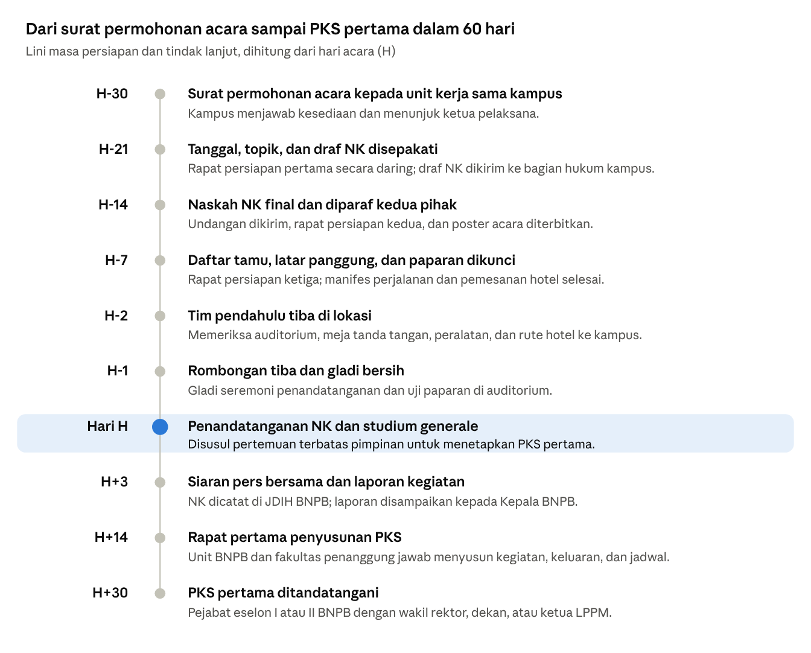

judul: Konsep Acara Studium Generale dan Penandatanganan Nota Kesepahaman BNPB dengan Perguruan Tinggi
judul_pendek: Konsep Acara Studium Generale dan Penandatanganan Nota Kesepahaman
subjudul: Rancangan topik, seremoni, tim, undangan, panitia, logistik, transportasi, anggaran, dan lini masa untuk satu kunjungan ke perguruan tinggi
tanggal: 11 November 2026
foto: C:/Users/USER/.claude/skills/ppt-konsultan/bnpb/assets/proyek-flagship/foto/kampus-ugm.jpg
kredit: Foto sampul: Alharomain354, Wikimedia Commons, lisensi CC BY-SA 4.0.

# Ringkasan Eksekutif
Acara ini dirancang sebagai satu rangkaian setengah hari di kampus mitra. Rangkaian dimulai dengan penandatanganan Nota Kesepahaman (NK) oleh Kepala BNPB dan Rektor, dilanjutkan dengan *studium generale* yang dibawakan Kepala BNPB, dan ditutup dengan pertemuan terbatas pimpinan untuk menyepakati Perjanjian Kerja Sama (PKS) pertama.
Tim BNPB yang berangkat dari Jakarta berjumlah 11 orang bila Kepala BNPB hadir dan 7 orang bila Kepala BNPB diwakili. Panitia gabungan berjumlah sekitar 45 orang, yaitu 11 orang dari BNPB dan sekitar 34 orang dari kampus. Peserta yang ditargetkan adalah 500 sampai 1.000 mahasiswa dan dosen, ditambah 60 sampai 80 tamu undangan.
Perkiraan biaya yang ditanggung BNPB adalah sekitar Rp89 juta untuk kampus di Jawa, sekitar Rp107 juta untuk kampus di luar Jawa, dan sekitar Rp42 juta untuk kampus di Bandung atau sekitar Jakarta. Perkiraan biaya yang ditanggung kampus sebagai tuan rumah adalah sekitar Rp81 juta.
> Semua angka biaya di dokumen ini adalah angka perencanaan. Angka tersebut harus dicocokkan dengan Standar Biaya Masukan (SBM) tahun anggaran berjalan sebelum diajukan.

# 1. Latar dan Tujuan
## Latar
*Studium generale* dipakai sebagai pintu masuk kerja sama karena satu kunjungan dapat menghasilkan tiga hal sekaligus. Ketiga hal itu adalah NK yang ditandatangani, perhatian sivitas akademika terhadap penanggulangan bencana, dan pertemuan pimpinan untuk menyusun PKS. Pola ini sudah dicoba pada Studium Generale ITB (mata kuliah KU-4078) tanggal 7 Oktober 2026.
## Tujuan acara
1. Acara ini menjadi tempat penandatanganan NK antara BNPB dan perguruan tinggi tentang Tridharma Perguruan Tinggi dalam Penanggulangan Bencana.
2. Kepala BNPB menyampaikan arah kebijakan penanggulangan bencana dan peran kampus secara langsung kepada mahasiswa dan dosen.
3. Kedua pihak menyepakati paling sedikit satu PKS turunan beserta penanggung jawabnya dalam 30 hari setelah acara.
4. BNPB memperkenalkan rencana program kerelawanan dan kuliah kerja nyata (KKN) tematik kebencanaan yang akan dibuka ke depan. Pada acara ini belum ada pendaftaran.
## Kampus sasaran
Status NK yang sudah ada menentukan urutan kampus sasaran. Kampus yang NK-nya sudah berakhir atau akan segera berakhir menjadi prioritas.
%% 14,20,24,42
| Kampus | NK terakhir | Masa berlaku | Peluang kerja sama |
| --- | --- | --- | --- |
| ITB | 23 Februari 2017 | Sudah berakhir pada Februari 2022. | BNPB dan ITB perlu menandatangani NK baru. |
| UGM | 22 Februari 2022 | Berlaku sampai Februari 2027. | NK perlu diperpanjang sebelum masa berlakunya habis. |
| UMY | 29 Februari 2024 | Berlaku sampai Februari 2029. | Kerja sama cukup dilanjutkan dengan PKS turunan. |
| Unpad | 24 Juni 2026 | Berlaku sampai Juni 2031. | Kerja sama cukup dilanjutkan dengan PKS turunan. |
| Kampus lain | Belum ada | Belum ada. | NK baru disusun dengan templat NK perguruan tinggi koordinator. |
Naskah NK disiapkan dari templat yang sudah ada, yaitu Templat NK BNPB dan Perguruan Tinggi Koordinator tanggal 2 November 2026 di folder 05 MoU.

# 2. Rekomendasi Topik Studium Generale
Tema payung yang disarankan untuk semua kampus adalah "Kampus Tangguh, Bangsa Tangguh: Peran Perguruan Tinggi dalam Penanggulangan Bencana". Subtopik dipilih dari daftar di bawah dan disesuaikan dengan ancaman bencana utama di wilayah kampus serta fakultas yang paling kuat di kampus itu.
%% 5,17,21,32,25
| No | Subtopik | Kampus yang cocok | Isi pokok paparan | PKS turunan yang ditawarkan |
| --- | --- | --- | --- | --- |
| 1 | Tridharma untuk ketangguhan bangsa | Semua kampus dengan peserta lintas fakultas | Paparan membahas peta risiko bencana Indonesia, kebijakan BNPB, serta peran pendidikan, riset, dan pengabdian. | Kerangka kerja sama lima tahun |
| 2 | Data dan kecerdasan buatan untuk peringatan dini | Fakultas teknik, informatika, dan sains data, misalnya di ITB, ITS, UI, dan Telkom University | Paparan membahas pemantauan *hotspot*, prediksi banjir, dan Satu Data Bencana. | Riset bersama dan magang data |
| 3 | Kebakaran hutan dan lahan serta gambut | Kampus di Sumatra dan Kalimantan, misalnya Unri, Unsri, UPR, Untan, dan IPB | Paparan membahas pola musim kebakaran, pembasahan gambut, dan patroli berbasis masyarakat. | Pusat studi gambut dan posko mahasiswa |
| 4 | Gempa, tsunami, dan bangunan tahan gempa | Kampus di jalur subduksi, misalnya USK, Unand, Unhas, UGM, dan ITB | Paparan membahas sejarah gempa besar, kesiapsiagaan sekolah, dan audit bangunan. | Kajian risiko bangunan publik |
| 5 | Banjir, rob, dan kota pesisir | Kampus di kota pesisir, misalnya Undip, ITS, Unhas, dan UI | Paparan membahas penurunan tanah, rob, dan tata ruang berbasis risiko. | Kajian kota pesisir bersama pemerintah daerah |
| 6 | Hidup berdampingan dengan gunung api | Kampus di sekitar gunung api aktif, misalnya UGM, UPN Veteran Yogyakarta, dan Unsrat | Paparan membahas status gunung api, jalur evakuasi, dan pemulihan ekonomi warga. | Pemetaan jalur evakuasi |
| 7 | Kesehatan dalam situasi bencana | Fakultas kedokteran, keperawatan, dan kesehatan masyarakat | Paparan membahas layanan kesehatan di pengungsian dan kesehatan jiwa penyintas. | Tim medis darurat kampus |
| 8 | Pendanaan risiko bencana | Fakultas ekonomi dan bisnis | Paparan membahas dana bersama penanggulangan bencana, asuransi aset, dan peran dunia usaha. | Kajian pendanaan daerah |
| 9 | Komunikasi risiko dan penanganan hoaks | Fakultas ilmu sosial dan komunikasi | Paparan membahas cara warga menerima peringatan dan cara menangani kabar bohong saat bencana. | Kampanye literasi bencana |
| 10 | Kerelawanan dan KKN tematik kebencanaan | Semua kampus, terutama badan eksekutif mahasiswa dan unit kegiatan mahasiswa | Paparan membahas peran relawan, standar keselamatan, dan rencana program ke depan. | Korps relawan kampus dan KKN tematik |
Kepala BNPB membawakan satu subtopik utama selama 45 menit. Subtopik 10 ditambahkan selama 10 menit sebagai pemberitahuan rencana program ke depan. Bahan paparan disusun dengan mesin bahan paparan BNPB dan dilengkapi halaman daftar pakar kebencanaan di kampus tersebut.

# 3. Seremoni dan Susunan Acara
Penandatanganan NK ditempatkan sebelum *studium generale*. Dengan urutan ini, Kepala BNPB membuka kuliah dengan kerja sama yang sudah sah, dan media mendapat foto utama di awal acara.
## Susunan acara
%% 10,12,48,30
| Waktu | Durasi | Kegiatan | Penanggung jawab |
| --- | --- | --- | --- |
| 07.00 | 60 menit | Peserta dan tamu mendaftar ulang, lalu duduk di auditorium paling lambat pukul 07.50. | Seksi peserta kampus |
| 07.45 | 15 menit | Kepala BNPB tiba, disambut Rektor di lobi, lalu beristirahat sejenak di ruang VIP. | Protokol kampus dan BNPB |
| 08.00 | 10 menit | Pembawa acara membuka acara, hadirin menyanyikan Indonesia Raya serta Mars atau Hymne kampus, lalu doa dibacakan. | Seksi acara kampus |
| 08.10 | 5 menit | Mahasiswa menampilkan kesenian, misalnya tari daerah. | Kampus |
| 08.15 | 10 menit | Rektor menyampaikan sambutan. | Kampus |
| 08.25 | 20 menit | Kepala BNPB dan Rektor menandatangani NK sesuai rincian seremoni di bawah. | Biro Hukum, Organisasi, dan Kerja Sama BNPB dan bagian kerja sama kampus |
| 08.45 | 5 menit | Kedua pimpinan bertukar cendera mata dan berfoto bersama di panggung. | Protokol |
| 08.50 | 45 menit | Kepala BNPB menyampaikan *studium generale*. | Tenaga Ahli Kepala BNPB dan operator paparan |
| 09.35 | 30 menit | Moderator dari kampus, yaitu dekan atau kepala pusat studi bencana, memandu tanya jawab. | Kampus |
| 10.05 | 10 menit | BNPB memberitahukan rencana program korps relawan dan KKN tematik kebencanaan ke depan, tanpa membuka pendaftaran. | BNPB dan badan eksekutif mahasiswa |
| 10.15 | 15 menit | Peserta berfoto bersama, dan Kepala BNPB melayani wawancara media. | Humas BNPB dan kampus |
| 10.30 | 45 menit | Pimpinan kedua lembaga beramah tamah dan membahas rencana PKS pertama dalam pertemuan terbatas. | Rektor, Kepala BNPB, wakil rektor, dan ketua LPPM |
| 11.15 | 45 menit | Rombongan mengunjungi laboratorium atau pusat studi bencana kampus bila waktu memungkinkan. | Kampus |
| 12.00 | 30 menit | Rombongan makan siang, lalu dilepas oleh pimpinan kampus. | Kampus |
LPPM adalah Lembaga Penelitian dan Pengabdian kepada Masyarakat.
## Rincian seremoni penandatanganan
Seremoni penandatanganan berlangsung selama 20 menit dengan urutan sebagai berikut.
1. Pembawa acara mengundang Kepala BNPB dan Rektor ke meja penandatanganan dengan iringan musik instrumental.
2. Pembawa acara membacakan pokok NK selama sekitar dua menit, yaitu judul, nomor dari kedua pihak, ruang lingkup, dan jangka waktu lima tahun.
3. Dua petugas naskah, masing-masing dari BNPB dan dari kampus, membuka map dan menunjukkan halaman tanda tangan. Naskah sudah diparaf di setiap halaman sebelum hari acara.
4. Kepala BNPB dan Rektor menandatangani rangkap masing-masing. Petugas kemudian menukar map, dan kedua pimpinan menandatangani rangkap kedua.
5. Kedua pimpinan berdiri, bertukar map NK, berjabat tangan menghadap kamera, dan berfoto dengan latar logo kedua lembaga.
6. Saksi dari kedua pihak, yaitu wakil rektor dan pejabat eselon I atau II BNPB, ikut berfoto bila dikehendaki.
Bila waktu memungkinkan, PKS dapat ditandatangani sesaat setelah NK oleh pejabat di bawah pimpinan, yaitu Deputi atau Direktur BNPB bersama wakil rektor, dekan, atau ketua LPPM. Dengan cara ini, kerja sama langsung memiliki kegiatan yang berjalan.

# 4. Tim BNPB yang Berangkat
Tim berjumlah 11 orang dari Jakarta bila Kepala BNPB hadir. Tim dibagi menjadi tim pendahulu sebanyak 3 orang yang tiba dua hari sebelum acara dan rombongan pimpinan sebanyak 8 orang yang tiba sehari sebelum acara. BPBD provinsi setempat membantu di lapangan dan tidak dihitung dalam tim Jakarta.
%% 5,29,10,13,43
| No | Peran | Jumlah | Kelompok | Tugas utama |
| --- | --- | --- | --- | --- |
| 1 | Kepala BNPB | 1 | Rombongan | Kepala BNPB menandatangani NK dan menyampaikan *studium generale*. |
| 2 | Pejabat eselon I atau II pendamping, yaitu Deputi atau Direktur sesuai topik | 1 | Rombongan | Pejabat ini menjadi saksi NK, menandatangani PKS bila ada, dan memimpin pembahasan tindak lanjut. |
| 3 | Tenaga Ahli Kepala BNPB bidang riset dan kerja sama perguruan tinggi | 1 | Rombongan | Tenaga ahli menjadi penghubung utama dengan kampus dan bertanggung jawab atas materi paparan. |
| 4 | Ajudan Kepala BNPB | 1 | Rombongan | Ajudan mengatur jadwal dan kebutuhan pribadi Kepala BNPB. |
| 5 | Pengawal pribadi | 1 | Rombongan | Pengawal menjaga keamanan pribadi Kepala BNPB. |
| 6 | Pejabat Biro Hukum, Organisasi, dan Kerja Sama | 1 | Rombongan | Pejabat ini memegang naskah NK serta mengurus paraf dan nomor naskah. |
| 7 | Penulis siaran pers dari Humas | 1 | Rombongan | Penulis menyusun siaran pers dan mengatur wawancara media. |
| 8 | Fotografer dan videografer dari Humas | 1 | Rombongan | Fotografer membuat dokumentasi resmi dan konten media sosial. |
| 9 | Protokol BNPB | 1 | Pendahulu | Protokol memimpin gladi bersih serta mengatur tata tempat dan alur kedatangan. |
| 10 | Staf kerja sama Biro Hukum, Organisasi, dan Kerja Sama | 1 | Pendahulu | Staf ini menyerahkan naskah final serta memeriksa meja tanda tangan dan meterai. |
| 11 | Operator paparan dan teknis | 1 | Pendahulu | Operator menguji paparan, video, pengeras suara, dan cadangan berkas. |
Bila Kepala BNPB diwakili, tim menjadi 7 orang. Peran 1, 4, dan 5 tidak berangkat, pejabat pada peran 2 menjadi wakil Kepala BNPB, dan tugas peran 8 dirangkap oleh peran 7. Karena NK ditandatangani oleh Kepala BNPB, naskah perlu ditandatangani lebih dulu di Jakarta, dan seremoni di kampus berubah menjadi penyerahan naskah.

# 5. Rekomendasi Undangan Pemangku Kepentingan
Tamu undangan dibatasi 60 sampai 80 orang yang duduk di barisan depan. Mereka terdiri atas pimpinan kampus, pemerintah daerah, unsur Forum Koordinasi Pimpinan Daerah, instansi vertikal, kampus tetangga, dunia usaha, masyarakat sipil, mahasiswa, dan media. Undangan untuk tamu dari luar kampus dikirim atas nama Rektor, sedangkan BNPB mengirim surat pemberitahuan kepada gubernur.
%% 20,46,12,22
| Kelompok | Pihak yang diundang | Prioritas | Pengirim undangan |
| --- | --- | --- | --- |
| Pimpinan kampus | Rektor, wakil rektor, ketua senat, dekan, ketua LPPM, kepala pusat studi bencana, dan direktur kerja sama | Wajib | Kampus |
| Pemerintah provinsi | Gubernur atau Wakil Gubernur, Sekretaris Daerah, dan Kepala Pelaksana BPBD provinsi | Wajib | Kampus, didahului surat pemberitahuan dari BNPB |
| Pemerintah kabupaten dan kota | Bupati atau Wali Kota setempat dan Kepala Pelaksana BPBD kabupaten atau kota | Wajib | Kampus |
| Forum Koordinasi Pimpinan Daerah | Pangdam atau Danrem, Kapolda atau Kapolres, dan Kepala Kejaksaan Tinggi bila berkenan hadir | Dianjurkan | Kampus |
| Instansi vertikal | Kepala stasiun BMKG, Kepala Kantor SAR, Kepala LLDIKTI wilayah, dan perwakilan BRIN di daerah | Dianjurkan | Kampus |
| Kampus tetangga | Rektor atau wakil rektor perguruan tinggi negeri dan swasta di provinsi yang sama sebagai calon jejaring kampus koordinator | Dianjurkan | Kampus |
| Dunia usaha | BUMN dan perusahaan besar di wilayah itu melalui bagian tanggung jawab sosial, serta Kadin daerah | Pilihan | Kampus, setelah daftarnya disetujui BNPB |
| Masyarakat sipil | PMI provinsi, Forum Pengurangan Risiko Bencana, organisasi relawan, dan organisasi kemasyarakatan keagamaan | Dianjurkan | Kampus |
| Mahasiswa | Ketua badan eksekutif mahasiswa, unit kegiatan mahasiswa pecinta alam, korps sukarela PMI kampus, dan kelompok studi kebencanaan | Wajib | Kampus |
| Media | Media lokal cetak, televisi, dan daring, biro ANTARA, serta kontributor media nasional | Wajib | Humas kampus dan Humas BNPB |
LLDIKTI adalah Lembaga Layanan Pendidikan Tinggi. Daftar tamu final dikunci tujuh hari sebelum acara dan dikirim ke protokol BNPB untuk menyusun urutan sapaan dalam sambutan Kepala BNPB.

# 6. Kebutuhan Panitia
Panitia gabungan berjumlah sekitar 45 orang, yaitu 34 orang dari kampus sebagai tuan rumah dan 11 orang tim BNPB yang merangkap seksi sesuai perannya. Pengarah acara adalah Rektor dan Kepala BNPB. Ketua pelaksana berasal dari kampus, sedangkan Tenaga Ahli Kepala BNPB menjadi penghubung tunggal di pihak BNPB.
%% 20,20,18,42
| Seksi | Orang kampus | Orang BNPB | Tugas utama |
| --- | --- | --- | --- |
| Ketua pelaksana | 1 orang, yaitu wakil rektor bidang kerja sama atau ketua LPPM | 1 orang, yaitu Tenaga Ahli Kepala BNPB | Ketua memimpin rapat persiapan dan memutuskan hal teknis. |
| Sekretariat | 2 | 0 | Sekretariat menyiapkan surat undangan, notula rapat, daftar hadir, dan laporan akhir. |
| Acara dan protokol | 4 orang, termasuk pembawa acara | 1 orang protokol | Seksi ini menyusun susunan acara, gladi bersih, tata tempat duduk, dan naskah pembawa acara. |
| Naskah NK | 2 orang dari bagian hukum dan kerja sama | 2 orang dari Biro Hukum, Organisasi, dan Kerja Sama | Seksi ini menyelaraskan naskah dan mengurus paraf, nomor, meterai, serta cetakan rangkap asli. |
| Materi dan teknis | 3 | 1 orang operator paparan | Seksi ini menyiapkan layar, proyektor atau layar LED, pengeras suara, siaran langsung, dan cadangan daya. |
| Peserta dan registrasi | 5 | 0 | Seksi ini mengurus pendaftaran daring, presensi dengan kode QR, dan pengisian kursi auditorium. |
| Konsumsi | 3 | 0 | Seksi ini menyiapkan rehat kopi tamu, kotak kudapan peserta, dan makan siang pimpinan. |
| Perlengkapan dan dekorasi | 4 | 0 | Seksi ini menyiapkan panggung, latar panggung, meja tanda tangan, bendera, dan papan nama. |
| Humas, publikasi, dan dokumentasi | 3 | 2 orang, yaitu penulis siaran pers dan fotografer | Seksi ini menyiapkan poster, media sosial, undangan media, siaran pers bersama, serta foto dan video. |
| Transportasi dan akomodasi | 2 | 0 | Seksi ini mengurus penjemputan di bandara, kendaraan, dan hotel tim BNPB. |
| Keamanan dan kesehatan | 3 orang dari satuan pengamanan dan klinik kampus | 1 orang pengawal pribadi | Seksi ini mengatur jalur VIP, koordinasi dengan kepolisian, ambulans siaga, dan jalur evakuasi gedung. |
| Penghubung tamu VIP | 2 | 1 orang ajudan | Seksi ini mendampingi Kepala BNPB dan tamu utama sejak tiba sampai pulang. |
| Pimpinan dan saksi | 0 | 2 orang, yaitu Kepala BNPB dan pejabat pendamping | Pimpinan dan saksi tidak bertugas teknis. |
| **Jumlah** | **34** | **11** | |
Rapat persiapan bersama cukup dilakukan tiga kali secara daring, yaitu 21, 14, dan 7 hari sebelum acara. Gladi bersih di lokasi dilakukan sehari sebelum acara.

# 7. Kebutuhan Logistik
Logistik dibagi menurut penyedianya. BNPB membawa naskah, cendera mata, dan bahan paparan, sedangkan kampus menyediakan tempat, panggung, dan konsumsi. Daftar di bawah dipakai sebagai daftar periksa saat gladi bersih.
%% 16,46,18,20
| Kelompok | Barang | Jumlah | Penyedia |
| --- | --- | --- | --- |
| Naskah NK | Naskah NK rangkap asli yang sudah diparaf di setiap halaman | 2 rangkap | BNPB dan kampus |
| Naskah NK | Map naskah bersampul kulit dengan logo lembaga | 2 buah | BNPB 1 buah dan kampus 1 buah |
| Naskah NK | Meterai Rp10.000 | 4 lembar, yaitu 2 terpakai dan 2 cadangan | BNPB |
| Naskah NK | Pena tanda tangan bertinta hitam | 4 buah | BNPB |
| Naskah NK | Cap dinas kedua lembaga | 1 set | Masing-masing lembaga |
| Naskah NK | Salinan cetak naskah untuk saksi dan arsip | 4 eksemplar | BNPB |
| Meja tanda tangan | Meja bertaplak, dua kursi, serta bendera meja Merah Putih, BNPB, dan kampus | 1 set | Kampus |
| Panggung | Latar panggung atau layar LED berisi judul acara, logo BNPB, logo kampus, dan logo KRIS | 1 | Kampus, dengan desain yang disetujui BNPB tujuh hari sebelum acara |
| Panggung | Podium, empat mikrofon nirkabel, mikrofon podium, dan monitor pembicara | 1 set | Kampus |
| Panggung | Kursi sofa pimpinan, meja kecil, dan papan nama tamu utama | 1 set | Kampus |
| Paparan | Laptop utama dan cadangan, penunjuk slide, serta berkas paparan di dua flashdisk | 2 laptop | BNPB |
| Paparan | Video pembuka profil BNPB berdurasi dua sampai tiga menit | 1 | BNPB |
| Cendera mata | Plakat BNPB untuk Rektor | 1 | BNPB |
| Cendera mata | Buku atau bingkisan BNPB untuk wakil rektor, dekan, dan moderator | 4 sampai 6 | BNPB |
| Cendera mata | Cendera mata kampus untuk Kepala BNPB dan pejabat pendamping | 2 | Kampus |
| Bahan peserta | Buku saku siaga bencana atau stiker | 500 eksemplar | BNPB |
| Publikasi | Poster digital, spanduk jalan masuk, umbul-umbul, dan papan petunjuk arah | Jumlahnya disesuaikan dengan lokasi. | Kampus |
| Publikasi | Siaran langsung di kanal YouTube kampus yang disiarkan ulang oleh BNPB | 1 kanal utama | Kampus |
| Ruang | Auditorium berkapasitas 500 sampai 1.000 kursi, ruang VIP, ruang rapat terbatas 20 kursi, dan ruang media | 4 ruang | Kampus |
| Konsumsi | Rehat kopi tamu VIP, kotak kudapan peserta, dan makan siang pimpinan | Rinciannya ada di bagian anggaran. | Kampus |
| Kesehatan | Ambulans siaga, petugas klinik, dan kotak pertolongan pertama | 1 tim | Kampus |
Logo KRIS dipasang di latar panggung dan seluruh bahan cetak sesuai ketentuan identitas dokumen yang berlaku sejak 9 November 2026.

# 8. Kebutuhan Transportasi
Moda perjalanan ditentukan oleh jarak kampus dari Jakarta, sedangkan transportasi lokal disediakan kampus dengan dukungan BPBD provinsi. Kepala BNPB sebagai pejabat negara memakai kelas bisnis untuk penerbangan, sedangkan anggota tim lain memakai kelas ekonomi.
## Perjalanan dari Jakarta ke kota kampus
%% 14,20,22,15,29
| Jarak dari Jakarta | Contoh kota | Moda | Waktu tempuh | Catatan |
| --- | --- | --- | --- | --- |
| Dekat | Bogor, Depok, dan Bandung | Kendaraan dinas BNPB, atau kereta cepat untuk tujuan Bandung | 1 sampai 3 jam | Rombongan dapat berangkat pada pagi hari acara tanpa menginap. |
| Menengah | Semarang, Yogyakarta, Surabaya, dan Malang | Pesawat, atau kereta untuk tim pendahulu | 1 sampai 1,5 jam penerbangan | Rombongan tiba pada sore hari sebelum acara. |
| Jauh | Banda Aceh, Padang, Pekanbaru, Palembang, Pontianak, Palangka Raya, dan Makassar | Pesawat | 1,5 sampai 3 jam penerbangan | Rombongan tiba sehari sebelum acara, dan jadwal penerbangan pulang pada hari acara perlu diperiksa lebih dulu. |
## Transportasi lokal di kota kampus
%% 30,9,37,24
| Kendaraan | Jumlah | Penumpang atau muatan | Penyedia |
| --- | --- | --- | --- |
| Mobil pimpinan berupa sedan atau MPV premium | 1 | Kepala BNPB, ajudan, dan pengawal pribadi | BPBD provinsi atau kampus |
| Mobil pejabat pendamping | 1 | Pejabat eselon I atau II dan Tenaga Ahli Kepala BNPB | Kampus |
| Minibus berkapasitas 12 sampai 15 kursi | 1 | Anggota tim BNPB lainnya | Kampus atau sewa |
| Mobil barang atau mobil bak tertutup | 1 | Naskah, cendera mata, bahan peserta, dan spanduk | Kampus |
| Kendaraan pengawalan | 1 | Pengawalan polisi bila sudah dikoordinasikan dengan kepolisian setempat | Polda atau Polres melalui surat kampus |
| Mobil cadangan | 1 | Mobil ini disiagakan bila ada kendaraan yang bermasalah. | Kampus |
## Pengaturan pendukung
- Manifes penumpang dan nomor penerbangan dikirim ke seksi transportasi kampus paling lambat tiga hari sebelum acara.
- Penjemputan di bandara memakai ruang tunggu VIP bila tersedia, dan pengaturannya dikoordinasikan oleh kampus atau BPBD provinsi dengan pengelola bandara.
- Hotel tim dipilih sedekat mungkin dengan kampus, dengan waktu tempuh paling lama 20 menit.
- Tim pendahulu menguji rute dari hotel ke kampus pada jam yang sama dengan jadwal hari acara.
- Kepulangan dijadwalkan paling cepat tiga jam setelah acara selesai, karena pertemuan terbatas dapat berlangsung lebih lama dari rencana.

# 9. Kebutuhan Anggaran
Biaya ditanggung oleh masing-masing pihak sesuai pola pasal pembiayaan NK. BNPB menanggung perjalanan dinas tim dan bahan yang dibawanya, sedangkan kampus menanggung tempat, panggung, konsumsi, dan transportasi lokal.
## Beban BNPB untuk 11 orang
Perhitungan memakai asumsi berikut. Tim pendahulu yang terdiri atas 3 orang bertugas selama 3 hari 2 malam, dan rombongan yang terdiri atas 8 orang bertugas selama 2 hari 1 malam. Dengan demikian, uang harian dihitung untuk 25 hari kerja perorangan. Contoh kota di Jawa adalah Yogyakarta, sedangkan contoh kota di luar Jawa adalah Makassar.
%% 24,36,20,20
| Pos biaya | Rincian | Kampus di Jawa (Rp) | Kampus di luar Jawa (Rp) |
| --- | --- | --- | --- |
| Tiket pesawat pulang pergi | 1 tiket kelas bisnis dan 10 tiket kelas ekonomi | 28.000.000 | 44.000.000 |
| Uang harian | 25 hari kerja perorangan | 10.500.000 | 10.750.000 |
| Penginapan | 1 kamar Kepala BNPB, 1 kamar pejabat pendamping, dan 12 malam kamar untuk tim | 17.300.000 | 17.300.000 |
| Taksi Jakarta ke bandara pulang pergi | 11 orang | 5.500.000 | 5.500.000 |
| Cendera mata | 1 plakat dan 6 bingkisan | 5.500.000 | 5.500.000 |
| Naskah NK | 2 map kulit, biaya cetak, dan meterai | 2.000.000 | 2.000.000 |
| Bahan peserta | 500 buku saku atau stiker | 7.500.000 | 7.500.000 |
| Dokumentasi dan konten | Video pembuka, penyuntingan, dan konten media sosial | 5.000.000 | 5.000.000 |
| Cadangan | 10 persen dari jumlah pos di atas | 8.130.000 | 9.755.000 |
| **Jumlah** | | **89.430.000** | **107.305.000** |
Bila kampus berada di Bandung atau sekitar Jakarta, pos tiket dan sebagian besar penginapan tidak diperlukan. Rombongan berangkat pada pagi hari acara dengan kendaraan dinas, hanya tim pendahulu yang menginap, dan beban BNPB turun menjadi sekitar Rp42 juta.
## Beban kampus sebagai tuan rumah
%% 30,46,24
| Pos biaya | Rincian | Perkiraan (Rp) |
| --- | --- | --- |
| Tempat | Auditorium milik kampus | 0 |
| Tata suara, cahaya, dan layar LED | Sewa satu hari termasuk gladi | 20.000.000 |
| Panggung dan dekorasi | Latar panggung, bunga, dan meja tanda tangan | 10.000.000 |
| Kudapan peserta | 800 kotak dengan harga Rp20.000 per kotak | 16.000.000 |
| Makan siang pimpinan dan tamu | 60 orang dengan harga Rp120.000 per orang | 7.200.000 |
| Rehat kopi tamu VIP | 80 orang dengan harga Rp50.000 per orang | 4.000.000 |
| Transportasi lokal | Minibus selama dua hari, mobil barang, dan bahan bakar | 5.000.000 |
| Publikasi cetak | Spanduk, umbul-umbul, dan papan arah | 5.000.000 |
| Konsumsi panitia | 34 orang selama dua hari dengan harga Rp50.000 per orang per hari | 3.400.000 |
| Penampilan seni | Tari atau paduan suara mahasiswa | 3.000.000 |
| Siaran langsung dan dokumentasi | Peralatan dan operator kampus | 3.000.000 |
| Cendera mata kampus | 2 buah | 2.000.000 |
| Kesehatan dan keamanan | Ambulans siaga dan lembur satuan pengamanan | 2.000.000 |
| **Jumlah** | | **80.600.000** |
## Catatan anggaran
- Tarif tiket, uang harian, dan penginapan adalah angka perencanaan. Angka tersebut perlu dicocokkan dengan Peraturan Menteri Keuangan tentang Standar Biaya Masukan tahun anggaran berjalan sebelum diajukan.
- Honorarium narasumber dan moderator tidak dihitung. Bila kampus memberi honorarium kepada pejabat BNPB, pejabat tersebut mengikuti aturan gratifikasi dan melaporkannya sesuai ketentuan.
- Bila ada sponsor dari dunia usaha, dukungannya diarahkan ke bahan peserta atau konsumsi, tidak ke perjalanan dinas, dan dicatat oleh kampus.

# 10. Lini Masa Persiapan dan Tindak Lanjut
Persiapan acara membutuhkan 30 hari sejak surat permohonan acara dikirim ke unit kerja sama kampus. Surat ini dikirim pada tahap 5 alur kerja sama, yaitu setelah program prioritas dan draf NK disepakati, sehingga hitungan 30 hari ini adalah bagian akhir dari alur yang lebih panjang. Acara baru dianggap berhasil bila PKS pertama ditandatangani paling lambat 30 hari setelah acara.

Tonggak yang paling sering terlambat adalah paraf naskah NK. Karena itu, naskah dikunci 14 hari sebelum acara, bukan 7 hari sebelum acara.

# 11. Risiko dan Keputusan Pimpinan
Risiko terbesar adalah Kepala BNPB batal hadir karena terjadi bencana besar. Karena itu, setiap acara memerlukan skenario cadangan yang disepakati dengan kampus paling lambat 14 hari sebelum acara.
## Risiko dan langkah cadangan
%% 26,26,48
| Risiko | Dampak | Langkah pencegahan dan cadangan |
| --- | --- | --- |
| Kepala BNPB batal hadir karena bencana atau tugas mendadak. | NK tidak dapat ditandatangani di tempat acara. | Naskah ditandatangani lebih dulu di Jakarta, dan seremoni berubah menjadi penyerahan naskah oleh pejabat yang mewakili. *Studium generale* dibawakan oleh wakil atau melalui sambungan video. |
| Paraf naskah NK terlambat. | Seremoni tertunda atau naskah yang ditandatangani keliru. | Naskah dikunci 14 hari sebelum acara. Nama, gelar, dan dasar pengangkatan Rektor dicocokkan dengan surat keputusan terbaru. |
| Auditorium tidak penuh. | Acara terlihat sepi di foto dan pemberitaan. | *Studium generale* dijadikan bagian mata kuliah wajib atau diberi poin kegiatan mahasiswa, dan pendaftaran daring dibuka 14 hari sebelum acara. |
| Ada unjuk rasa atau pertanyaan tentang isu sensitif saat tanya jawab. | Acara terganggu dan pemberitaan menjadi negatif. | Moderator memilah pertanyaan, dan humas menyiapkan pokok jawaban untuk isu bencana terkini di wilayah itu. |
| Cuaca buruk atau penerbangan terganggu. | Rombongan terlambat tiba. | Rombongan tiba sehari sebelum acara, dan susunan acara cadangan memperpanjang sambutan Rektor serta penampilan seni. |
| Nama atau gelar ditulis keliru. | Kesalahan terlihat di depan publik. | Kepala BNPB ditulis Letnan Jenderal TNI Kristomei Sianturi, S.Sos., M.Si. (Han). Protokol memeriksa semua papan nama dan naskah pembawa acara sehari sebelum acara. |
## Keputusan yang perlu diambil pimpinan
1. Pimpinan menetapkan kampus sasaran pertama dan tanggal acara.
2. Pimpinan memilih bentuk NK, yaitu NK baru dengan templat perguruan tinggi koordinator atau perpanjangan NK lama, misalnya NK dengan UGM yang berakhir pada Februari 2027.
3. Pimpinan memilih subtopik utama *studium generale* dari daftar di bagian 2.
4. Pimpinan menunjuk pejabat eselon I atau II pendamping dan menetapkan PKS pertama yang akan ditawarkan.
5. Pimpinan menyetujui anggaran BNPB dan menetapkan mata anggaran yang dibebani.

# 12. Daftar Singkatan
Daftar ini menjelaskan singkatan yang dipakai dalam dokumen.
%% 22,78
| Singkatan | Kepanjangan atau arti |
| --- | --- |
| BMKG | Badan Meteorologi, Klimatologi, dan Geofisika |
| BNPB | Badan Nasional Penanggulangan Bencana |
| BPBD | Badan Penanggulangan Bencana Daerah |
| BRIN | Badan Riset dan Inovasi Nasional |
| BUMN | Badan Usaha Milik Negara |
| Kadin | Kamar Dagang dan Industri |
| KKN | Kuliah kerja nyata |
| KRIS | Kolaborasi, Responsif, Integratif, Sinkronisasi; identitas program Kepala BNPB yang logonya dipasang di setiap dokumen |
| LED | Light-emitting diode; jenis layar panggung |
| LLDIKTI | Lembaga Layanan Pendidikan Tinggi |
| LPPM | Lembaga Penelitian dan Pengabdian kepada Masyarakat |
| MPV | Multi-purpose vehicle; jenis mobil penumpang berkapasitas enam sampai delapan orang |
| NK | Nota Kesepahaman, yang juga disebut MoU |
| PKS | Perjanjian Kerja Sama |
| PMI | Palang Merah Indonesia |
| QR | Quick response; kode batang dua dimensi untuk presensi dan pendaftaran |
| SAR | Search and rescue; pencarian dan pertolongan, yang di daerah dijalankan Kantor SAR milik Basarnas |
| SBM | Standar Biaya Masukan |
| VIP | Very important person; sebutan untuk tamu utama |
| ITB, ITS, UGM, UI, UMY, Unand, Undip, Unhas, Unpad, Unri, Unsrat, Unsri, Untan, UPR, USK | Institut Teknologi Bandung, Institut Teknologi Sepuluh Nopember, Universitas Gadjah Mada, Universitas Indonesia, Universitas Muhammadiyah Yogyakarta, Universitas Andalas, Universitas Diponegoro, Universitas Hasanuddin, Universitas Padjadjaran, Universitas Riau, Universitas Sam Ratulangi, Universitas Sriwijaya, Universitas Tanjungpura, Universitas Palangka Raya, dan Universitas Syiah Kuala |
