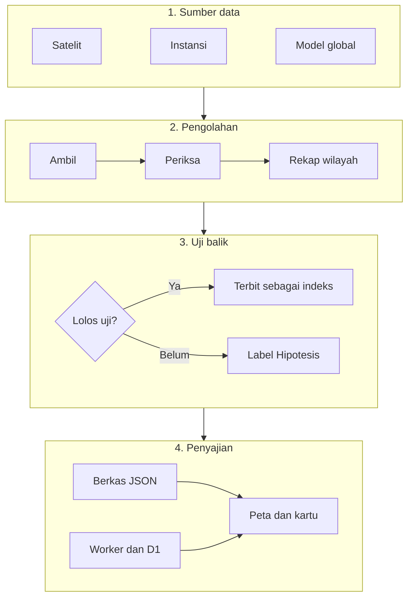
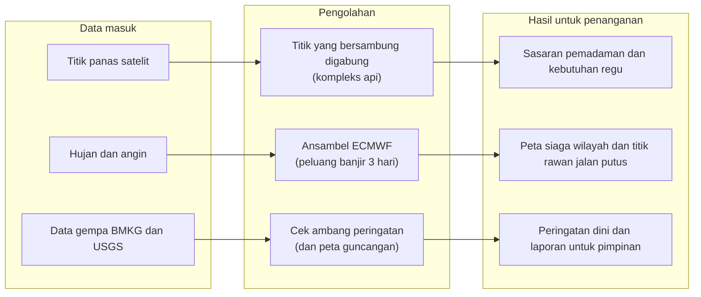
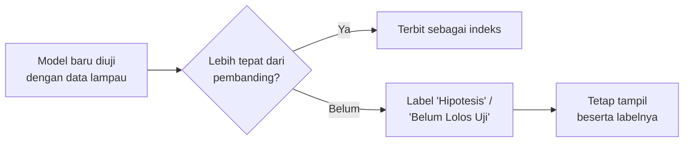

# Cara Kerja Centurisk97

Dokumen ini menerangkan dari mana data Centurisk97 diambil, bagaimana data itu diolah, dan bagaimana angka serta peringatan di layar dihitung.

---

## 1. Alur data

Data diambil otomatis dari satelit dan instansi pemerintah, diperiksa dan dirapikan, lalu ditampilkan di peta.

Rincian tiap sumber ada di bagian 2. Jalurnya ada dua:

- **Berkas statis.** Skrip Python di GitHub Actions mengolah data secara terjadwal, lalu menerbitkan hasilnya sebagai berkas JSON.
- **Data cepat.** Data yang harus segera tampil, yaitu titik panas FIRMS, gempa, peringatan dini cuaca (*nowcast*), dan status gunung api, ditarik langsung oleh Cloudflare Worker ke basis data D1 tanpa menunggu skrip Python.

---

## 2. Sumber data

Sumbernya terbagi tiga kelompok.

### a. Satelit
- **NASA FIRMS (VIIRS di satelit S-NPP dan NOAA-20)**: titik panas (*hotspot*) kebakaran hutan dan lahan dengan ukuran piksel 375 meter. Data baru diambil tiap 3 jam, tetapi tiap satelit hanya melintas sekitar dua kali sehari.
- **Himawari-9 (Badan Meteorologi Jepang)**: satelit cuaca yang diam di atas satu titik dan memotret tiap 10 menit. Deteksi titik panasnya diambil tiap 30 menit untuk menangkap api baru di sela lintasan VIIRS.
- **Sentinel-2 dan Landsat**: citra beresolusi tinggi. Sentinel dipakai untuk melihat kondisi terbaru kompleks api prioritas dan bekas banjir. Landsat dipakai untuk mengukur mundurnya garis pantai akibat abrasi dari tahun ke tahun.

### b. Instansi pemerintah
- **BMKG**: gempa (*autogempa*, gempa terkini M 5,0 ke atas, dan gempa dirasakan) serta peringatan dini cuaca (*nowcast*) berupa poligon wilayah yang berlaku 2–3 jam.
- **PVMBG / MAGMA ESDM**: status gunung api (Level I Normal sampai Level IV Awas), laporan letusan, dan peringatan abu vulkanik untuk penerbangan (VONA).
- **KLHK (SiPongi)**: rekap resmi luas kebakaran hutan dan lahan serta hasil pengecekan lapangan (*ground check*) oleh Manggala Agni.
- **BNPB (InaRISK dan DIBI)**: peta risiko bencana daerah, riwayat kejadian bencana, dan daftar fasilitas penanganan bencana.
- **BRGM**: peta 518 Kesatuan Hidrologis Gambut (KHG). Gambut perlu dipantau tersendiri karena apinya bisa merambat jauh ke bawah permukaan.

### c. Model dan katalog global
- **ECMWF (melalui Open-Meteo)**: prakiraan hujan dan embusan angin 10 hari, serta peluang hujan lebat dari 51 anggota ansambel.
- **CAMS Copernicus**: perkiraan sebaran partikel halus (PM2.5), sulfur dioksida, dan karbon monoksida.
- **USGS**: katalog gempa internasional, dipakai sebagai pembanding dan pelengkap data BMKG.
- **GEM Global Active Faults**: peta sesar aktif.

---

## 3. Jadwal pengolahan

Semua berjalan otomatis. Tidak ada server yang perlu dirawat sendiri.

| Kapan | Sumber | Yang dikerjakan |
| --- | --- | --- |
| **Tiap menit** (cron Worker) | BMKG dan USGS, sistem internal | Menarik gempa terbaru, memeriksa ambang peringatan, menjalankan antrean dan membersihkan data lama |
| **Tiap 10 menit** | *Nowcast* BMKG | Memperbarui peringatan dini cuaca |
| **Tiap 30 menit** | Himawari-9, MAGMA ESDM | Mengambil titik panas baru dan status gunung api |
| **Tiap jam** | Sistem internal | Memeriksa apakah data yang tayang sudah basi; kalau basi, data diterbitkan ulang |
| **Tiap 3 jam** | NASA FIRMS (VIIRS) | Mengambil titik panas terbaru, mencocokkannya dengan batas wilayah, lalu menyimpannya ke basis data |
| **07.01–07.40** | Worker | Draf laporan harian karhutla (07.01), arsip sitrep (07.05), daftar pengingat Ruang Koordinasi (07.40) |
| **07.20** | Banjir dan rob | Hujan, ansambel, sungai, rob, status tiap daerah |
| **08.10** | Gempa | Laporan harian, catatan gempa susulan, laju dan peluang gempa |
| **09.10** | Lintas bencana | Cuaca ekstrem, gunung api (MAGMA, abu, laporan), kekeringan |
| **01.40 dan 13.40** | Kualitas udara | PM2.5 dari CAMS |
| **21.20** | Karhutla | Titik panas, kompleks api, indeks cuaca kebakaran (FWI), kompleks yang berada di areal konsesi |

Semua jam dalam WIB. GitHub Actions bisa terlambat beberapa menit, kadang puluhan menit, dari jadwalnya.

Hasil olahan disimpan sebagai berkas JSON yang sudah ringkas, sehingga peta dan dasbor tetap ringan dibuka di ponsel maupun laptop.

---

## 4. Cara menghitung, per jenis bencana

Data mentah diolah menjadi informasi yang bisa langsung dipakai petugas dan warga:

### a. Kebakaran hutan dan lahan (karhutla)
- **Kompleks api.** Titik panas VIIRS 7 hari terakhir dirangkai dengan metode ST-DBSCAN. Dua titik dianggap bersambung bila jaraknya tidak lebih dari 1,5 kali ukuran pikselnya (0,6–1,5 km) dan selisih waktunya tidak lebih dari 48 jam. Satu rangkaian titik yang bersambung disebut satu kompleks api. Dengan begitu petugas melihat satu hamparan kebakaran, bukan puluhan koordinat yang terpisah-pisah.
- **Taksiran luas.** Dihitung dari luas piksel. Satu piksel VIIRS kira-kira 14 hektare bila tepat di bawah satelit, dan lebih luas di tepi sapuan. Satu piksel juga bisa hanya terbakar sebagian. Angka ini gambaran awal sebelum luas resmi dari KLHK keluar.
- **Kapan kompleks dianggap masih aktif.** Bila ada titik baru dalam 72 jam terakhir. Di gambut yang sangat kering batasnya 7 hari, karena bara di bawah permukaan bisa luput dari satelit saat tertutup awan atau asap.
- **Kebutuhan pemadaman.** Untuk tiap kompleks aktif dihitung beban kerjanya: regu-hari untuk membuat garis kendali di sisi api yang masih menjalar, regu-hari untuk memadamkan sisa bara gambut, jumlah titik bor, dan hari kerja helikopter. Perhitungannya memakai jenis tanah (gambut atau mineral), posko dan sumber daya terdekat, serta akses jalan. Petugas memilih target selesai antara 1 dan 14 hari, lalu beban itu dibagi menjadi kebutuhan personel, regu, pompa, dan selang. Setiap koefisien punya nilai rendah, tengah, dan tinggi, lengkap dengan sumbernya. Helikopter *water bombing* hanya dipakai untuk mendinginkan api di depan regu darat, bukan sebagai andalan utama.
- **Simulasi penjalaran api 24, 48, dan 72 jam.** Ada dua mesin:
  - Model statistik (GBDT) yang dilatih dari riwayat sebaran titik panas. Model ini dijalankan berulang kali (Monte Carlo) dengan prakiraan cuaca untuk menghitung peluang tiap kotak 375 m ikut terbakar.
  - Simulasi fisika berbasis sistem FBP Kanada di tab Simulasi. Simulasi ini membandingkan beberapa pilihan tindakan (regu dari posko, Daops, MPA desa, helikopter, sekat bakar, modifikasi cuaca) berdasarkan luas lahan yang bisa diselamatkan dalam 72 jam.

  Hasil keduanya adalah **prakiraan model, bukan hasil pengamatan**. Simulasi fisikanya juga belum divalidasi untuk kondisi Indonesia, dan hal ini ditulis jelas di layar. Kinerja model statistik dicatat di `model_sebaran.json` dan terus diuji dengan kejadian baru di `prospektif.json`.

### b. Banjir dan rob
- **Peluang banjir.** Yang dihitung adalah peluang hujan ekstrem 1 sampai 3 hari ke depan dari ansambel ECMWF, bukan ramalan pasti yang mudah meleset.
- **Kiriman air dari hulu.** Hujan lebat di hulu digabung dengan perkiraan waktu tempuh air ke hilir, untuk 16 daerah rawan.
- **Rob di pesisir.** Menggabungkan gelombang tinggi, pasang surut, dan lokasi penurunan muka tanah.

### c. Gempa dan tsunami
- *Autogempa* BMKG ditarik tiap menit. Gempa terkini, gempa dirasakan, dan katalog USGS ditarik tiap 5 menit. Bila satu gempa tercatat di BMKG dan USGS dengan selisih waktu paling lama 90 detik dan jarak paling jauh 100 km, keduanya dianggap gempa yang sama. Magnitudo, lokasi, dan nomornya tetap memakai data BMKG.
- Gempa yang dirasakan dipetakan tingkat guncangannya (*shakemap*, skala MMI). Bila ada potensi tsunami, peringatan langsung muncul di bagian atas layar.
- **Tidak ada keterangan tidak sama dengan aman.** Bila BMKG tidak menyebut apa pun soal tsunami, layar menulis "BMKG tidak menyebut tsunami", bukan "tidak berpotensi tsunami". Kalimat "tidak berpotensi tsunami" hanya dipakai bila BMKG sendiri yang menyatakannya.

### d. Cuaca ekstrem
- **Status tiap kecamatan untuk 3 hari ke depan.** Setiap kecamatan memakai prakiraan hujan dan embusan angin dari kotak terdekat, peluang hujan lebat dari ansambel ECMWF, dan tinggi gelombang untuk wilayah pesisir.
- **Peringatan dini BMKG.** Poligon *nowcast* BMKG diambil tiap 10 menit dan ditampilkan sesuai aslinya.

### e. Kualitas udara (PM2.5)
- Peta sebaran partikel halus diambil dari model CAMS. Layar menyebutkan bahwa angka ini hasil perhitungan model atmosfer dan belum dikoreksi dengan alat ukur di lapangan.

### f. Gunung api
- Status dari PVMBG ditampilkan bersama peta Kawasan Rawan Bencana (KRB). Peringatan abu vulkanik disandingkan dengan arah angin di lapisan atas untuk memperkirakan ke mana abu akan terbawa.

### g. Kekeringan
- Kekurangan hujan jangka panjang dipantau dengan indeks kekeringan baku SPI-3 dan SPI-6, digabung dengan tingkat kekeringan tanah.

---

## 5. Lapor Warga

Warga bisa melaporkan apa yang mereka lihat (api atau asap, kualitas udara, keluhan kesehatan, listrik, jaringan, BBM, LPG), meminta atau menawarkan bantuan, dan mengunggah foto atau video.

- **Laporan teks** langsung tampil di peta. Warga lain bisa menandai laporan itu benar atau salah. Laporan otomatis disembunyikan bila sedikitnya 3 orang menandainya salah dan jumlah tanda salahnya lebih banyak daripada tanda benar.
- **Foto dan video** baru tampil setelah disetujui admin. Lokasinya diambil dari GPS ponsel saat mengunggah (akurasi 1 km atau lebih baik, dibaca paling lama 10 menit sebelumnya), jadi pengunggah tidak bisa menaruh titik di sembarang tempat. Bila foto masih menyimpan lokasi dan waktu pemotretan dari kamera, keduanya dicocokkan. Foto yang diambil lebih dari 5 km dari lokasi unggah, atau lebih dari 48 jam sebelumnya, ditolak.
- **Batas kiriman** untuk mencegah spam:
  - paling banyak 10 laporan per jam dan 30 laporan per hari dari satu jaringan;
  - paling banyak 5 foto per jam;
  - laporan yang sama dari orang yang sama di titik yang sama ditolak selama 30 menit;
  - bila laporan baru dari semua orang melebihi 600 per jam, kiriman ditolak sementara.

**Perlindungan data pelapor:**

- Metadata berkas (EXIF, XMP, lokasi dari kamera, profil perangkat) dihapus sebelum foto atau video disimpan. Video berformat WebM belum bisa dibersihkan.
- Alamat IP tidak disimpan. Yang disimpan hanya hasil acakannya (*hash* dengan *salt*), dan itu pun hanya untuk menghitung batas kiriman. Email dan hasil acakan IP tidak pernah ditampilkan ke publik.
- Untuk jenis laporan tertentu, koordinat dibulatkan hingga ketelitian sekitar 1 km.
- Nomor kontak dihapus begitu laporan selesai atau disembunyikan. Laporan dihapus permanen 7 hari setelah masa berlakunya habis. Laporan yang disembunyikan dihapus 30 hari kemudian.
- Setiap tindakan admin (menyembunyikan, menampilkan, menghapus) tercatat di log audit.

---

## 6. Ruang Koordinasi BNPB

Halaman `/bnpb` menjadi ruang kerja bersama BNPB, BPBD, dan relawan. Isinya:

- arsip laporan situasi (sitrep) harian;
- meja kerja harian staf;
- pendaftaran dan penugasan relawan;
- forum tanya-jawab (alun-alun);
- indeks risiko per kecamatan;
- perkiraan kebutuhan sumber daya per musim;
- kumpulan riset.

Sitrep dan draf laporan harian disusun otomatis setiap pagi dari data yang sama dengan peta publik, lalu dilengkapi oleh tim.

---

## 7. Prinsip kejujuran data dan uji balik

Centurisk97 berpegang pada keterbukaan dan kehati-hatian dalam menyajikan informasi.

1. **Status resmi instansi selalu didahulukan.**
   Hasil perhitungan Centurisk97 tidak pernah menggantikan status darurat resmi dari BNPB, BMKG, atau PVMBG.
2. **Setiap model wajib diuji dengan data lampau (uji balik).**
   Setiap rumus atau model risiko diuji dengan catatan bencana yang sudah terjadi. Model baru dianggap layak bila terbukti lebih tepat daripada tiga pembanding sederhana: tebakan acak, anggapan bahwa hari ini sama dengan kemarin, dan perkiraan yang hanya berdasarkan jumlah penduduk.
3. **Model yang belum lolos tetap tampil, dengan label.**
   Bila sebuah model belum terbukti tepat (misalnya ambang kekeringan SPI atau indeks kebakaran permukiman di Jakarta), angkanya tidak disembunyikan. Angka tetap bisa dilihat publik, tetapi diberi label jelas: **"Hipotesis"** atau **"Belum Lolos Uji"**.
4. **Bahasa lugas dan sesuai fakta.**
   - Judul kartu atau laporan hanya berisi kejadian, angka, dan sumber resmi.
   - Tidak memakai kata-kata dramatis, slogan, atau gaya bahasa yang seolah-olah alam punya kehendak.
   - Titik api di areal perkebunan atau konsesi ditulis apa adanya, misalnya "titik panas berada di dalam areal konsesi", tanpa menuduh pihak mana pun sebelum ada putusan pengadilan.
5. **Data kosong tidak dibaca sebagai kabar baik.**
   Bila sumber tidak memberi keterangan, Centurisk97 tidak menyimpulkan keadaan "aman". Contohnya pada gempa: tanpa pernyataan tsunami dari BMKG, layar menulis "BMKG tidak menyebut tsunami", bukan "tidak berpotensi tsunami". Begitu juga kompleks api yang tidak terdeteksi selama 24 jam: kompleks itu tidak langsung dianggap padam karena bisa saja tertutup awan, dan di gambut yang sangat kering tetap dihitung aktif sampai 7 hari.
6. **Klaim di berita dicocokkan dengan data satelit.**
   Judul berita nasional dalam 7 hari terakhir yang menyebut suatu kabupaten atau provinsi "nihil titik api", "bebas api", atau "padam total" dibandingkan dengan deteksi satelit. Klaim itu ditandai bertentangan bila satelit masih mendeteksi kompleks aktif sedikitnya 6 jam setelah berita terbit (minimal 1 kompleks di kabupaten tersebut, atau 5 kompleks di provinsi tersebut). Klaim yang lebih umum, seperti "api di X sudah padam", hanya dihitung bila ada kompleks dalam jarak 10 km dari lokasi yang disebut.

---

## 8. Keterbatasan data

Perhatikan hal-hal berikut saat membaca angka di layar.

- **Awan dan asap tebal bisa menutupi api.** Satelit hanya bisa menangkap panas yang tidak terhalang. Hari tanpa titik panas belum tentu hari tanpa api, terutama di gambut yang bisa terus membara di bawah permukaan.
- **Satu titik panas tidak sama dengan satu hektare lahan terbakar.** Satu piksel VIIRS kira-kira 14 hektare bila tepat di bawah satelit dan lebih luas di tepi sapuan, dan piksel itu bisa hanya terbakar sebagian. Taksiran luas dari piksel hanya gambaran awal. Angka resmi tetap dari KLHK.
- **Tidak semua titik panas berarti kebakaran lahan.** Titik dalam radius 3 km dari puncak gunung api aktif dicatat sebagai aktivitas gunung api, bukan karhutla. Suar gas industri dan permukaan panas lain juga bisa ikut terdeteksi.
- **Satelit tidak memantau terus-menerus.** Tiap satelit VIIRS hanya melintas sekitar dua kali sehari, jadi api yang muncul lalu padam di antara dua lintasan bisa terlewat. Himawari membantu menutup celah itu, tetapi resolusinya jauh lebih kasar (sekitar 2 km).
- **PM2.5 berasal dari model**, belum dikoreksi dengan alat ukur di lapangan.
- **Model sebaran dan simulasi hanyalah prakiraan.** Pakailah untuk membandingkan pilihan tindakan, bukan sebagai kepastian luas atau arah api.
- **Data bisa terlambat.** GitHub Actions dan sumber data luar kadang tertunda atau gagal. Kesegaran data diperiksa tiap jam dan data diterbitkan ulang bila sudah basi, tetapi data yang tampil tetap bisa tertinggal beberapa jam.
