# Benchmark DIBI BNPB dan Centurisk

Perbandingan data DIBI BNPB (dibi.bnpb.go.id) dengan data yang dipakai Centurisk (Pantau Bencana), dan rekomendasi data DIBI yang belum dipakai. Disusun 22 Okt 2026 dari kueri langsung ke API publik DIBI, kode repo, dan Buletin Info Bencana Agustus 2026.

Tangkapan layar diambil dari server lokal dengan data yang ter-commit di repo (lebar 1440 px). Gambar menunjukkan tempat data DIBI akan tampil bila rekomendasinya dikerjakan.

## Kesimpulan

Centurisk baru memakai sebagian kecil data DIBI, padahal sisanya bisa ditarik dengan cara yang sama tanpa izin tambahan.

1. **Peran keduanya saling melengkapi.** DIBI mencatat dampak resmi sesudah kejadian. Centurisk memantau dan memperkirakan sebelum dan selama kejadian. Dengan data DIBI yang lengkap, Centurisk menampilkan keduanya di satu layar.
2. **Yang sudah dipakai sedikit.** Baru 5 ukuran dampak dan 14 jenis bencana hidrometeorologi, dari satu dasbor. Data itu juga berhenti di 12 Okt 2026 karena tidak ditarik ulang.
3. **Empat data DIBI paling penting yang belum dipakai:**
   - **Status keadaan darurat** (117 berlaku pada 22 Okt 2026, dengan SK). Saat ini Centurisk memakai tingkat respons buatan sendiri.
   - **Korban hilang dan luka.** Angka korban tanpa keduanya terlalu rendah.
   - **Fasilitas rusak:** sekolah, fasyankes, rumah ibadah, kantor, jembatan. Kartu fasilitas sekarang kosong.
   - **Riwayat dampak karhutla, gempa, dan gunung api.** Halaman Dampak ketiganya belum punya angka resmi BNPB.
4. **Biayanya kecil.** Semua data itu ada di API publik DIBI yang sudah dipakai. Langkah pertama memperbaiki penarikan harian, lalu menambah kolom dan jenis di skrip yang sama (`scripts/banjir/kejadian.py`). Sesudah itu tinggal tampilan per halaman.

Rincian tiap data ada di bagian 4, urutan kerja di bagian 7.

## 1. Ringkasan

| | DIBI BNPB | Centurisk |
| --- | --- | --- |
| Peran | Catatan resmi dampak bencana sesudah kejadian | Pemantauan langsung, prakiraan, dan operasi |
| Sumber | Laporan BPBD, diverifikasi BNPB | Satelit, BMKG, MAGMA, model, laporan warga, akun instansi, DIBI |
| Kecepatan | Harian, jeda beberapa hari | Tiap 10 menit sampai harian |
| Cakupan | 13 kategori, 60 jenis bencana, 2008 sampai sekarang | 7 bencana alam dan kebakaran permukiman DKI |
| Satuan wilayah | Kabupaten/kota | Titik, sel kisi, kecamatan, kabupaten, provinsi |
| Dampak | 16 kolom angka kejadian, korban, dan kerusakan | 5 ukuran dari DIBI, sisanya keterpaparan dan model |
| Status resmi | SK status keadaan darurat | Tingkat respons buatan sendiri |
| Prakiraan dan peta | Tidak ada | Ada |
## 2. Isi DIBI

DIBI adalah Apache Superset dengan lima dasbor publik. Semua bisa ditarik lewat `POST /api/v1/chart/data` tanpa login.

| Dasbor | Data | Isi |
| --- | --- | --- |
| 1 Tentang DIBI, 2 Data Informasi Bencana | Dampak kejadian bencana | 62.849 baris, 1 Jan 2008 sampai 21 Okt 2026, per kabupaten per tanggal |
| 1 | Jenis dan kategori bencana | 60 jenis dalam 13 kategori, berkode |
| 1 | Metadata variabel dampak | 23 variabel dengan definisi, satuan, aturan validasi |
| 1 | Publikasi | 104 tautan: Buletin bulanan, Buku Data Bencana, jurnal |
| 1 | Batas wilayah | Provinsi dan kabupaten/kota versi BNPB |
| 83 Monitoring Status Darurat | Status keadaan darurat | 1.196 SK, Jan 2023 sampai sekarang |
| 52 Rambu IDRIP | Rambu evakuasi | Rambu per desa 2023, rekap korban per 100 ribu penduduk |

**Setahun terakhir (22 Okt 2025 sampai 21 Okt 2026):** 4.424 kejadian, 1.938 meninggal, 213 hilang, 9.712 luka, 11,1 juta menderita, 1,2 juta mengungsi, 407.627 rumah rusak.

**Tidak terbuka di DIBI publik** walau tercatat di metadata: kecamatan dan desa, koordinat, kronologi, panjang jalan rusak, luas sawah, lahan, kebun, dan hutan rusak, total taksiran kerugian.

## 3. Data DIBI yang sudah dipakai Centurisk

Ditarik oleh `scripts/banjir/kejadian.py` dan `scripts/banjir/rob.py` ke `public/banjir/data/kejadian.json`, lalu dibaca sekitar 20 skrip.

| Data DIBI | Dipakai untuk |
| --- | --- |
| Tanggal, tahun, provinsi, kabupaten, kode BPS | Semua turunan di bawah |
| 14 jenis hidrometeorologi: banjir, banjir genangan, banjir bandang, banjir dan longsor, banjir rob, tanah longsor, gerakan tanah, cuaca ekstrem, puting beliung, angin kencang, angin topan, kekeringan, kekeringan pertanian, gelombang pasang/abrasi | Riwayat dan kalender musim banjir, longsor, rob, cuaca, kekeringan |
| Jumlah kejadian | Tren, kalender musim, peringkat risiko, uji balik status banjir, ambang kekeringan, indeks risiko kecamatan |
| Meninggal | Ditarik, tapi belum tampil sebagai segmen sendiri |
| Menderita (tampil sebagai "terdampak") | Kartu Korban dan kerugian |
| Mengungsi | Kartu Korban dan kerugian |
| Rumah rusak berat, sedang, ringan (dijumlah) | Kartu Korban dan kerugian |
| SK status darurat 2025, khusus kekeringan (dari data.bnpb.go.id, statis) | Pil status resmi kekeringan |

**Masalah kesegaran.** `banjir.yml` hanya menjalankan `kejadian.py` bila berkasnya belum ada, jadi data DIBI di Centurisk berhenti di 12 Okt 2026.

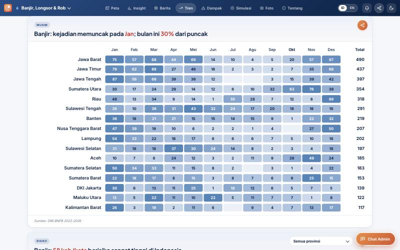

*Tren banjir, kartu "Musim": kalender kejadian dari DIBI. Kolom Okt hanya berisi kejadian sampai 12 Okt.*

## 4. Data DIBI yang belum dipakai, dengan rekomendasi

| No | Data DIBI | Rekomendasi | Prioritas |
| --- | --- | --- | --- |
| 4.1 | Status keadaan darurat (dasbor 83) | Pakai | Tinggi |
| 4.2 | Korban hilang dan luka/sakit | Pakai | Tinggi |
| 4.3 | Fasilitas rusak: pendidikan, fasyankes, rumah ibadah, kantor, jembatan | Pakai | Tinggi |
| 4.4 | Jenis karhutla, gempa, tsunami, gunung api, kebakaran permukiman | Pakai | Tinggi |
| 4.5 | Rumah terendam dan estimasi kerugian rumah | Pakai | Sedang |
| 4.6 | Jenis hidrometeorologi yang belum dipetakan | Pakai | Sedang |
| 4.7 | Kode jenis bencana resmi (60 kode) | Pakai | Sedang |
| 4.8 | Metadata variabel (23 variabel) | Pakai | Sedang |
| 4.9 | Rambu evakuasi IDRIP dan korban per 100 ribu penduduk | Pertimbangkan | Rendah |
| 4.10 | Epidemi, gagal teknologi, konflik sosial | Tidak dipakai | tidak ada |
| 4.11 | Batas wilayah BNPB dan daftar publikasi | Tidak dipakai | tidak ada |

Syarat semua rekomendasi: data DIBI ditarik ulang tiap hari (bagian 3).

### 4.1 Status keadaan darurat

**Isi DIBI.** 1.196 SK sejak Jan 2023: status (siaga darurat, tanggap darurat, transisi darurat ke pemulihan), jenis bencana, provinsi, kabupaten, tanggal mulai dan berakhir, skala, tautan dokumen SK. Berlaku pada 22 Okt 2026: 117 status (88 siaga, 10 tanggap darurat, 19 transisi); 72 di antaranya menyebut karhutla.

**Centurisk sekarang.** Kolom "Tingkat respons" di sitrep dan pil di `/semua` adalah tingkat buatan Pantau Bencana. SK resmi baru dipakai untuk kekeringan 2025.

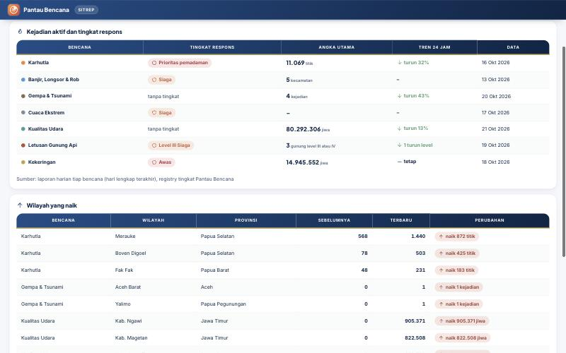

*Sitrep: tingkat respons buatan sendiri; status darurat resmi belum ada.*

**Rekomendasi.** Tarik harian ke JSON publik, tampilkan pil status resmi bertautan SK di halaman tiap bencana, sitrep, dan `/semua`. Status resmi didahulukan atas tingkat buatan sendiri, sesuai prinsip model dan data di buku pegangan.

**Berkas dan pengerja.** Skrip baru di `scripts/umum/` (`pipa-umum`); sitrep (`ruang-bnpb`); `/semua` (`inti-layar`).

### 4.2 Korban hilang dan luka/sakit

**Isi DIBI.** Kolom `hilang` dan `luka_sakit`. Setahun terakhir: 213 hilang, 9.712 luka.

**Centurisk sekarang.** Kartu Korban dan kerugian hanya punya Kejadian, Mengungsi, Terdampak, Rumah rusak. Meninggal ditarik tapi tidak punya segmen sendiri.

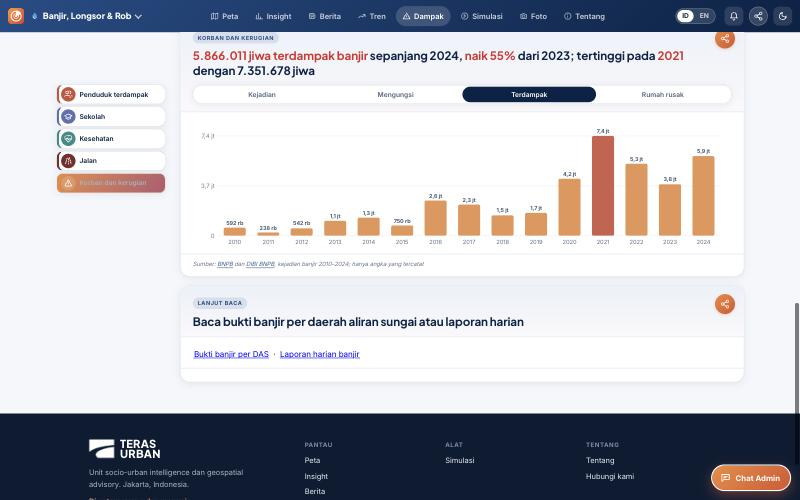

*Dampak banjir: empat segmen, tanpa meninggal, hilang, dan luka.*

**Rekomendasi.** Tarik kedua kolom. Tampilkan dengan pasangan baku DIBI dan Buletin, "meninggal dan hilang" serta "terdampak dan mengungsi", seragam di tujuh halaman Dampak.

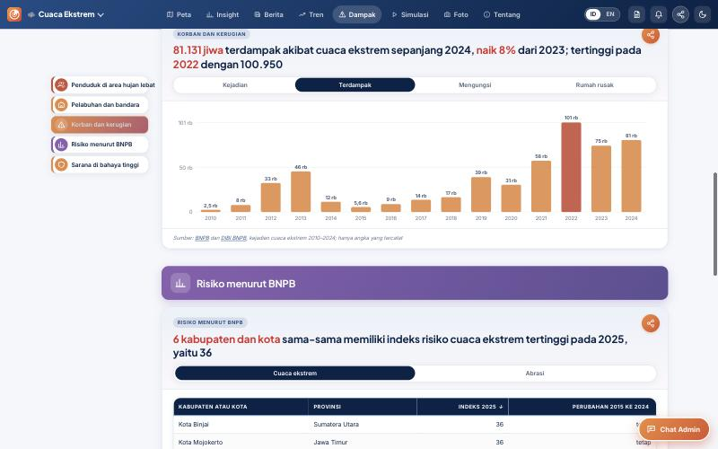

*Dampak cuaca ekstrem: susunan segmen yang akan diseragamkan.*

**Berkas dan pengerja.** `scripts/banjir/kejadian.py` (`banjir`); `public/<bencana>/dampak.js` (pengerja tiap bencana).

### 4.3 Fasilitas rusak

**Isi DIBI.** `pendidikan_rusak`, `fasyankes_rusak`, `rumah_ibadat_rusak`, `kantor_rusak`, `jembatan_rusak`. Buletin Agustus 2026 mencatat 1.705 satuan pendidikan, 515 rumah ibadah, 95 fasyankes, 533 kantor, dan 23 jembatan rusak dalam satu bulan.

**Centurisk sekarang.** Kartu Sekolah, Kesehatan, dan Jalan di Dampak banjir kosong, karena hanya bersandar pada peta fasilitas OSM di kecamatan berstatus.

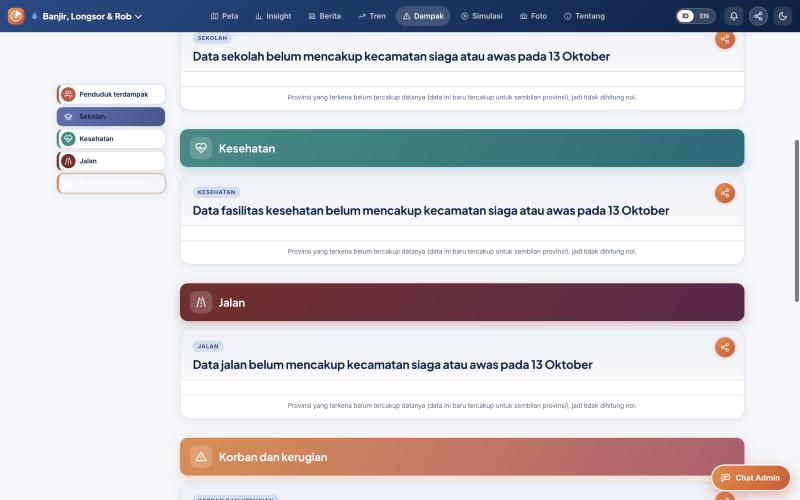

*Dampak banjir: kartu fasilitas tanpa angka.*

**Rekomendasi.** Isi kartu fasilitas dengan angka kerusakan tercatat DIBI per tahun dan per provinsi, berdampingan dengan keterpaparan OSM. Sitrep menampilkan total bulan berjalan untuk bahan rehab-rekon.

**Berkas dan pengerja.** `kejadian.py` (`banjir`); `dampak.js` tiap bencana; `public/bnpb/sitrep.js` (`ruang-bnpb`).

### 4.4 Jenis bencana di luar hidrometeorologi

**Isi DIBI.** Kebakaran Hutan dan Lahan (termasuk Kebakaran Lahan Gambut, kode 1063), Gempabumi, Tsunami, Erupsi Gunung Api (termasuk lahar dan hujan abu), Kebakaran Gedung dan Permukiman. Setahun terakhir: 1.235 kejadian karhutla, 31 gempa (160 meninggal, 142.128 rumah rusak), 15 erupsi, 197 kebakaran permukiman (127 meninggal).

**Centurisk sekarang.** Halaman Dampak gempa, karhutla, dan gunung api tidak punya riwayat korban dan kerusakan resmi; gempa hanya menampilkan keterpaparan InaRISK dan WorldPop.

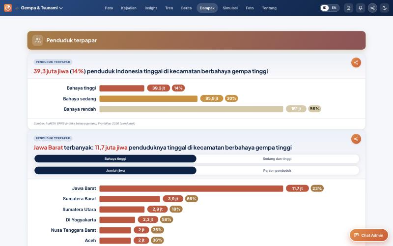

*Dampak gempa: hanya keterpaparan penduduk.*

**Rekomendasi.** Tambahkan kelima jenis ke pemetaan `DIBI_JENIS` di `kejadian.py` dan tampilkan riwayat di tab Dampak dan Tren tiap bencana. Catatan karhutla: DIBI mencatat kejadian yang dilaporkan BPBD (Jawa Tengah 187 di atas Riau 159), jadi dipakai sebagai angka dampak dan respons, bukan ukuran sebaran api. Ukuran sebaran tetap dari satelit.

**Berkas dan pengerja.** `kejadian.py` (`banjir`), lalu `dampak.js` dan `tren.js` milik `gempa`, `gunungapi-kering`, `layar-peta`.

### 4.5 Rumah terendam dan estimasi kerugian rumah

**Isi DIBI.** `rumah_terendam` dan `estimasi_kerugian_rumah` (dihitung DIBI dari rumah rusak berat, sedang, ringan).

**Centurisk sekarang.** Rumah terendam tidak dihitung; rumah rusak tampil tanpa nilai rupiah.

**Rekomendasi.** Tambahkan rumah terendam di kartu banjir dan rob. Estimasi kerugian rumah tampil dalam miliar rupiah sebagai angka DIBI, bukan hitungan kita sendiri.

**Berkas dan pengerja.** `kejadian.py`, `public/banjir/dampak.js` (`banjir`).

### 4.6 Jenis hidrometeorologi yang belum dipetakan

**Isi DIBI.** Hujan es, siklon tropis, suhu udara ekstrem (kategori cuaca ekstrem); kekeringan meteorologis dan hidrologis; banjir drainase dan selokan, banjir waduk, tanggul jebol.

**Centurisk sekarang.** Jenis ini tidak ada di `DIBI_JENIS`, jadi kejadiannya terbuang diam-diam.

**Rekomendasi.** Petakan ke kunci yang sudah ada (cuaca, kering, banjir). Perubahan kecil di `kejadian.py`.

### 4.7 Kode jenis bencana resmi

**Isi DIBI.** 60 jenis berkode dalam 13 kategori, misalnya 1070 Gempabumi, 1090 Erupsi Gunung Api, 1063 Kebakaran Lahan Gambut.

**Centurisk sekarang.** Ekspor Meja Kerja (`GET /api/meja/ekspor`, di balik login admin) memakai nama buatan sendiri tanpa kode:

```js
// src/meja.js:384
export const DIBI_JENIS = {banjir: "BANJIR", longsor: "TANAH LONGSOR", karhutla: "KEBAKARAN HUTAN DAN LAHAN",
  gempa: "GEMPA BUMI", tsunami: "TSUNAMI", gunungapi: "GUNUNG MELETUS", ...}
```

**Rekomendasi.** Pakai label dan kode resmi DIBI, tambah kolom `kode_jenis`. Ini menutup butir "Nama jenis bencana gaya DIBI di ekspor Meja" di daftar Belum diputus buku pegangan, dan membuat isian Meja bisa langsung masuk DIBI.

**Berkas dan pengerja.** `src/meja.js` (`warga-api`).

### 4.8 Metadata variabel

**Isi DIBI.** 23 variabel dengan definisi, konsep, satuan, kelas, dan aturan validasi.

**Centurisk sekarang.** Tab Metode menyebut DIBI dalam satu baris sebagai sumber.

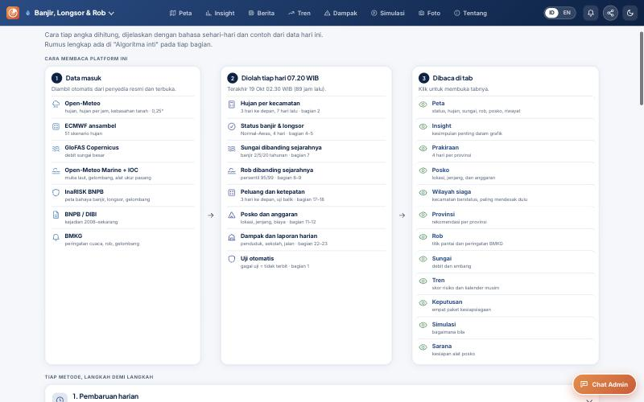

*Metode banjir: "BNPB / DIBI, kejadian 2008–sekarang" tanpa definisi.*

**Rekomendasi.** Tabel definisi dan satuan di bab sumber data tab Metode, supaya "terdampak", "mengungsi", dan "rumah rusak" di Centurisk bermakna sama dengan BNPB.

**Berkas dan pengerja.** `public/<bencana>/metode.js` (pengerja tiap bencana).

### 4.9 Rambu evakuasi IDRIP

**Isi DIBI.** Rambu dan papan evakuasi program IDRIP 2023 per desa (jenis rambu, kecamatan, desa), dan rekap korban per 100 ribu penduduk per kabupaten.

**Rekomendasi.** Pertimbangkan sebagai lapisan peta gempa dan tsunami (sebaran rambu evakuasi) bila ada koordinatnya; data publik hanya sampai desa. Prioritas rendah.

### 4.10 dan 4.11 Tidak direkomendasikan

- **Epidemi, gagal teknologi, konflik sosial**: di luar fokus Centurisk sebagai pemantau bencana alam.
- **Batas wilayah BNPB**: Centurisk sudah punya batas sendiri yang terpakai di semua lapisan.
- **Daftar publikasi**: cukup ditautkan di halaman Tentang bila perlu.

## 5. Yang Centurisk punya dan DIBI tidak

| Data Centurisk | Sumber |
| --- | --- |
| Titik panas dan luas terdampak hampir seketika | NASA FIRMS, Himawari-9 tiap 10 menit |
| Prakiraan dan peluang 3 hari | ECMWF ansambel, BMKG, GloFAS |
| Kualitas udara per kota | CAMS (perkiraan model) |
| Status gunung api dan gempa terkini | MAGMA, BMKG |
| Peta lapisan: gambut, KHG, konsesi, kawasan hutan, sesar | GFW, BRGM PRIMS, Pusgen |
| Kejadian berkode per bencana dengan masa aktif | Mesin kejadian Centurisk |
| Laporan warga berfoto, tugas dan verifikasi padam lapangan | Lapor Warga, Ruang Instansi |
| Keterpaparan penduduk dan fasilitas | InaRISK, WorldPop, OSM |

**Posisi.** DIBI mencatat dampak sesudah kejadian; Centurisk memberi peringatan sebelum dan selama kejadian. Dengan rekomendasi bagian 4, Centurisk menampilkan keduanya di satu layar.

## 6. Bentuk laporan

Buletin Info Bencana bulanan adalah keluaran DIBI yang paling dekat dengan laporan Centurisk.

| | Buletin Info Bencana (DIBI) | Laporan Centurisk |
| --- | --- | --- |
| Periode | Bulanan, terbit sekitar tiga minggu sesudah akhir bulan | Harian, otomatis |
| Isi | 5 angka kunci, per jenis, per provinsi, banding bulan yang sama tahun lalu, studi kejadian, potensi bulan depan | Titik panas dan luas per provinsi dan kab/kota, banding harian, kurva musim |
| Format | PDF Microsoft Publisher, tabel dan grafik berupa gambar | Halaman web, PDF berkop, PPTX, teks WhatsApp |

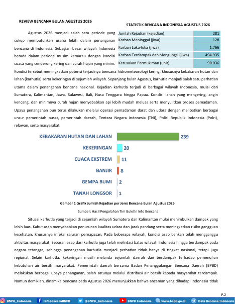

*Buletin halaman 3: angka kunci dan grafik per jenis bencana.*

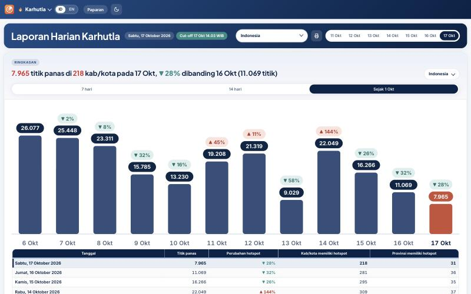

*Laporan harian karhutla Centurisk.*

**Yang bisa ditiru dari Buletin**, memakai data DIBI di bagian 4:
- **Banding bulan yang sama tahun lalu** untuk semua bencana. Saat ini baru karhutla yang punya.
- **Tren bulan yang sama 10 tahun** dan **rekap sejak awal tahun**, misalnya di `/semua`.
- **Rekap bulanan otomatis** dari snapshot, terbit tanggal 1.

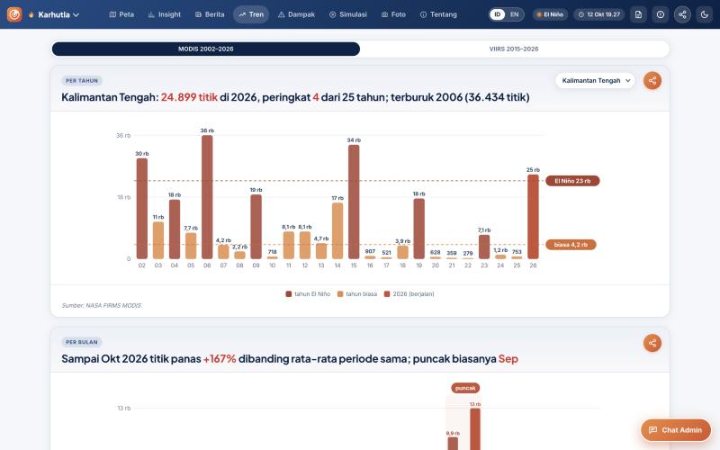

*Tren karhutla: pola banding yang bisa dibawa ke bencana lain.*

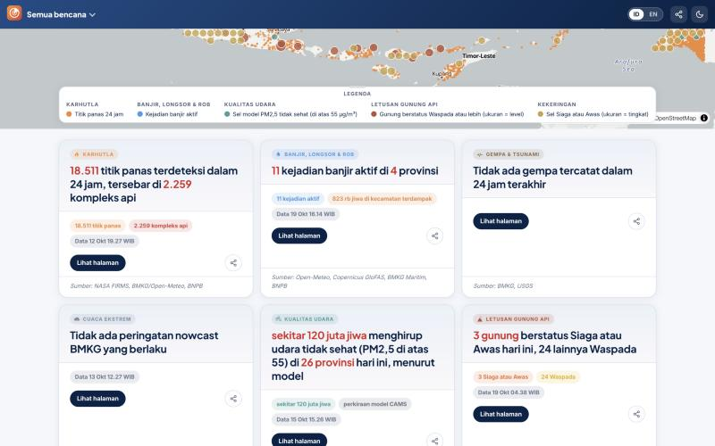

*`/semua`: baru berisi keadaan hari ini.*

**Konsistensi angka.** Buletin Agustus 2026 memuat angka yang tidak sama untuk hal yang sama:
- korban meninggal gempa NTT 121 vs 127;
- rumah rusak gempa NTT 89.643 vs 97.215;
- kedalaman gempa 10 vs 15 km.

Rekap otomatis dari satu snapshot terhindar dari selisih seperti ini.

## 7. Urutan kerja yang disarankan

1. Tarik ulang DIBI tiap hari (`banjir.yml`; di-commit pemilik lewat GitHub Desktop).
2. Dalam satu putaran `kejadian.py`: kolom 4.2, 4.3, 4.5 dan jenis 4.4, 4.6.
3. Status keadaan darurat (4.1).
4. Tampilan: segmen dampak seragam, kartu fasilitas, riwayat di Dampak gempa, karhutla, gunung api.
5. Kode jenis di ekspor Meja (4.7) dan metadata di Metode (4.8).
6. Banding tahun lalu, rekap sejak awal tahun, rekap bulanan (bagian 6), bila pemilik setuju.
