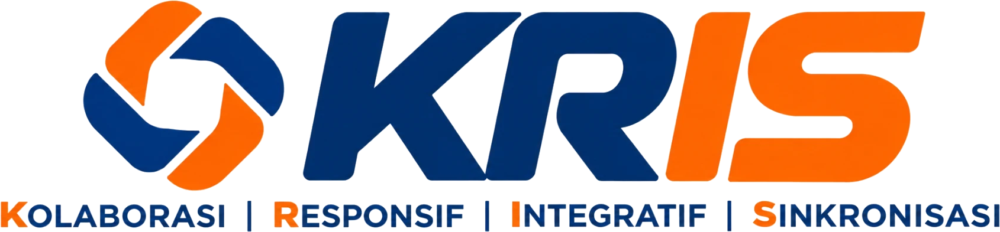

# Framework dalam Manajemen Kebencanaan

Disusun 11 November 2026 sebagai bahan rujukan studium generale dan kemitraan BNPB dengan perguruan tinggi.

Framework manajemen kebencanaan terbagi ke dalam enam kelompok: kerangka global, siklus manajemen bencana,
model konsep risiko, kerangka operasional, kerangka pemulihan, serta kerangka berbasis komunitas dan sektor.
Kelompok-kelompok itu saling melengkapi dan biasanya dipakai bersamaan. Indonesia menurunkannya ke dalam
peraturan dan rencana nasional yang dirangkum di bagian 7.

## 1. Kerangka global

Kerangka global menetapkan arah kebijakan pengurangan risiko bencana yang disepakati negara anggota PBB.

| Framework | Periode | Inti |
| --- | --- | --- |
| Yokohama Strategy | 1994 | Kerangka internasional pertama untuk pengurangan risiko bencana. |
| Hyogo Framework for Action | 2005 sampai 2015 | Lima prioritas aksi yang menggeser fokus dari respons ke pengurangan risiko. |
| Sendai Framework for Disaster Risk Reduction | 2015 sampai 2030 | Rujukan utama saat ini, dengan 4 prioritas aksi dan 7 target global. |
| Paris Agreement dan Tujuan Pembangunan Berkelanjutan (SDGs) | sejak 2015 | Mengaitkan pengurangan risiko bencana dengan adaptasi perubahan iklim dan pembangunan. |
| Early Warnings for All | 2022 sampai 2027 | Target PBB agar setiap orang terlindungi sistem peringatan dini. |
| Making Cities Resilient 2030 | sejak 2021 | Panduan dan jejaring ketangguhan kota. |

Empat prioritas Sendai Framework adalah:

1. Memahami risiko bencana.
2. Memperkuat tata kelola risiko bencana.
3. Berinvestasi dalam pengurangan risiko bencana untuk ketangguhan.
4. Meningkatkan kesiapsiagaan untuk respons yang efektif dan membangun kembali dengan lebih baik (Build Back Better).

Tujuh target global Sendai Framework mencakup penurunan angka kematian, jumlah warga terdampak, kerugian
ekonomi, dan kerusakan infrastruktur vital, serta peningkatan jumlah negara dengan strategi pengurangan risiko,
kerja sama internasional, dan akses ke peringatan dini.

Early Warnings for All memakai empat pilar sistem peringatan dini: pengetahuan risiko, pemantauan dan
prakiraan, penyebaran peringatan, serta kemampuan masyarakat untuk merespons.

## 2. Siklus manajemen bencana

Siklus manajemen bencana membagi penanganan bencana menjadi tahapan yang berulang.

| Model | Tahapan |
| --- | --- |
| Model empat fase | Mitigasi, kesiapsiagaan, tanggap darurat, serta pemulihan yang terdiri atas rehabilitasi dan rekonstruksi. |
| Model Indonesia menurut UU 24/2007 | Prabencana, saat tanggap darurat, dan pascabencana. |
| Disaster risk continuum | Tahapan dipandang tumpang tindih; misalnya, pemulihan dini sudah dimulai ketika tanggap darurat masih berjalan. |

Kalangan akademik memakai model kontinum karena siklus empat fase dianggap terlalu kaku untuk kejadian yang
berlangsung lama atau berantai.

## 3. Model konsep risiko

Model konsep risiko menjelaskan mengapa ancaman alam berubah menjadi bencana.

| Model | Inti |
| --- | --- |
| Persamaan risiko | Risiko sebanding dengan ancaman dikali kerentanan, dibagi kapasitas. BNPB memakainya untuk kajian risiko bencana dan InaRISK. |
| Pressure and Release (Blaikie dan kawan-kawan) | Bencana terjadi ketika ancaman bertemu kondisi tidak aman, yang lahir dari tekanan dinamis dan akar penyebab sosial, ekonomi, serta politik. |
| Access Model | Kerentanan rumah tangga ditentukan oleh aksesnya terhadap sumber daya, misalnya lahan, pendapatan, dan jaringan sosial. |
| Disaster Resilience of Place (Cutter) | Ketangguhan suatu tempat diukur dari sisi sosial, ekonomi, kelembagaan, infrastruktur, dan modal komunitas. |

Persamaan risiko yang dipakai BNPB ditulis sebagai rumus berikut.

```text
Risiko = Ancaman × Kerentanan / Kapasitas
```

## 4. Kerangka operasional

Kerangka operasional mengatur cara bekerja ketika bencana terjadi.

| Framework | Penerapan di Indonesia |
| --- | --- |
| Incident Command System | Diadopsi sebagai Sistem Komando Penanganan Darurat Bencana melalui Peraturan Kepala BNPB 3/2016. |
| Cluster Approach dari Inter-Agency Standing Committee PBB | Diterapkan sebagai delapan klaster nasional penanggulangan bencana: kesehatan, pencarian dan penyelamatan, logistik, pengungsian dan perlindungan, pendidikan, sarana dan prasarana, ekonomi, serta pemulihan dini. |
| Sphere Standards | Dipakai sebagai standar minimum bantuan kemanusiaan untuk air bersih, sanitasi, pangan, hunian, dan kesehatan. |
| Rencana kontinjensi | Disusun per ancaman sebelum kejadian, lalu diaktifkan menjadi rencana operasi saat tanggap darurat. |

## 5. Kerangka pemulihan

Kerangka pemulihan memastikan wilayah terdampak dibangun kembali dengan risiko yang lebih rendah.

| Framework | Inti |
| --- | --- |
| Build Back Better | Pembangunan kembali harus lebih aman daripada kondisi sebelum bencana; menjadi prioritas keempat Sendai Framework. |
| Post-Disaster Needs Assessment | Di Indonesia diterapkan sebagai Pengkajian Kebutuhan Pascabencana (Jitupasna), yang menjadi dasar rencana rehabilitasi dan rekonstruksi. |
| Disaster Recovery Framework (GFDRR dan Bank Dunia) | Panduan tata kelola, pendanaan, dan pelaksanaan pemulihan. |

## 6. Kerangka berbasis komunitas dan sektor

Kerangka ini menurunkan pengurangan risiko ke tingkat desa, sekolah, rumah sakit, dan kemitraan.

| Framework | Inti |
| --- | --- |
| Pengurangan Risiko Bencana Berbasis Komunitas (PRBBK) | Warga ikut mengkaji risiko, menyusun rencana, dan menjalankan kesiapsiagaan. |
| Desa dan Kelurahan Tangguh Bencana | Indikator ketangguhan tingkat desa menurut Peraturan Kepala BNPB 1/2012. |
| Satuan Pendidikan Aman Bencana | Keamanan sekolah dari sisi bangunan, manajemen bencana, dan pendidikan pengurangan risiko. |
| Hospital Safety Index (WHO) | Penilaian keamanan bangunan dan kesiapan fungsi rumah sakit saat bencana. |
| Pentahelix | Kolaborasi lima unsur: pemerintah, akademisi, dunia usaha, masyarakat, dan media. |

## 7. Payung hukum dan perencanaan di Indonesia

| Jenis | Rujukan |
| --- | --- |
| Undang-undang | UU 24/2007 tentang Penanggulangan Bencana. |
| Peraturan pemerintah | PP 21/2008 tentang Penyelenggaraan Penanggulangan Bencana. |
| Rencana jangka panjang | Rencana Induk Penanggulangan Bencana (RIPB) 2020 sampai 2044 melalui Perpres 87/2020. |
| Rencana lima tahunan | Rencana Nasional Penanggulangan Bencana, turunan RIPB. |
| Data dan kajian risiko | Indeks Risiko Bencana Indonesia (IRBI) dan InaRISK. |
| Layanan daerah | Standar Pelayanan Minimal sub-urusan bencana yang wajib dipenuhi pemerintah daerah. |

## 8. Pemakaian untuk studium generale dan kemitraan kampus

Empat framework paling mudah dibawakan kepada mahasiswa karena langsung menunjukkan peran perguruan tinggi:

1. Sendai Framework, karena prioritas pertamanya, memahami risiko bencana, adalah wilayah riset kampus.
2. Siklus manajemen bencana, karena setiap fase membutuhkan disiplin ilmu yang berbeda.
3. Persamaan risiko, karena kerentanan dan kapasitas dapat diturunkan lewat pendidikan, riset, dan pengabdian.
4. Pentahelix, karena akademisi adalah salah satu dari lima unsur kolaborasi.

Nomor pasal dan tahun peraturan di dokumen ini perlu dicocokkan dengan naskah resmi di JDIH BNPB atau
peraturan.bpk.go.id sebelum dikutip dalam naskah resmi.
