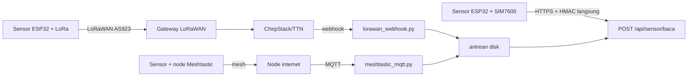

# Sensor lapangan BNPB (firmware, gateway, simulator)

Perangkat murah untuk melengkapi mata di desa: tinggi muka air sungai, hujan, gerakan tanah, muka air gambut, asap/CO.
Semua dibangun agar begitu perangkat keras tiba, tinggal rakit, flash, pasang. Sisi server: `POST /api/sensor/baca`
(kontrak di `docs/superpowers/specs/2026-11-01-logbook-pusdalops-design.md`, bagian Sensor).

> STATUS JUJUR: kode Python lulus uji. Kelima firmware SUDAH dikompilasi (PlatformIO 6.2, espressif32 6.9.0, arduino-esp32 2.0.17,
> RadioLib 6.6.0, TinyGSM 0.12.0) untuk env `lorawan`, `seluler`, `meshtastic`; BELUM diuji di perangkat keras (pin, jaringan, modem, sirene).
> Ukuran (lorawan, config contoh): tma 342 KB, hujan 343 KB, longsor 359 KB, gambut 358 KB, gas 344 KB flash (26-27% dari 1,3 MB), RAM 7,7%. Seluler 326-350 KB, meshtastic 288-312 KB.
> Seluler memakai AT+HTTP* bawaan modem SIM7600/A7670 (TinyGSM tidak punya klien TLS untuk SIM7600); alurnya belum dicoba pada modem sungguhan.
> Nama bidang telemetri Meshtastic (`rainfall_1h`, `distance`) belum diverifikasi ke versi firmware node. Ambang di `ambang.json` titik awal, bukan keputusan.

## Peta berkas

| Berkas | Isi |
| --- | --- |
| `payload.py` / `firmware/lib/bnpb_sensor/payload.h` | kodek biner kembar (jaga sama; diuji) |
| `ambang.json`, `ambang.py` | ambang per jenis + dasar; penilai untuk simulator/uji |
| `firmware/{tma,hujan,longsor,gambut,gas}/` | proyek PlatformIO; `include/config.example.h` -> salin ke `config.h` |
| `firmware/lib/bnpb_sensor/` | pustaka bersama: watchdog, baterai, median, deep sleep, kirim LoRaWAN/seluler/Meshtastic |
| `gateway/lorawan_webhook.py` | webhook ChirpStack/TTN -> decode -> POST bertanda |
| `gateway/meshtastic_mqtt.py` | Meshtastic MQTT -> sensor + laporan `LAPOR` |
| `gateway/penanda.py` | HMAC + antrean disk simpan-lalu-teruskan |
| `gateway/kunci_alat.py` | turunkan kunci alat dari kunci induk, isi config.h |
| `sim/simulasi.py` | simulator 10 skenario tanpa perangkat keras |
| `tests/sensor/` | uji tanpa perangkat keras |

Uji: `python3 -m unittest discover -s tests/sensor -p 'test_*.py'` (dari akar repo).

## Kontrak ke server

`POST /api/sensor/baca`, badan JSON `{"alat","waktu":"2026-11-01T03:04:05Z","nilai":{...},"baterai":3.98,"rssi":-97}`,
header `X-Sensor-Tanda` = HMAC-SHA256 heksadesimal huruf kecil atas BYTE badan persis seperti dikirim.
Kunci penanda = kunci alat = `HMAC-SHA256(SENSOR_KUNCI_INDUK, alat_id)` heks (string heks itu sendiri, UTF-8, jadi kunci HMAC badan).
`waktu` = waktu KIRIM (UTC, +-10 menit dari jam server). `waktu_asli` = waktu ukur, boleh sampai 24 jam ke belakang (bacaan susulan).
Badan ditulis ringkas (`separators=(",",":")`).

Laporan desa tanpa sinyal: `POST /api/sensor/lapor` `{alat, waktu, pengirim_node, teks}`, ditandatangani kunci alat milik gateway.

Kunci `nilai` per jenis (satuan): 

| Jenis | Kunci |
| --- | --- |
| tma | `tinggi_cm`, `laju_cm_jam`, `n` (bacaan sah; 0 = sensor rusak) |
| hujan | `mm10`, `mm60`, `tips` (penghitung berputar 0..65535) |
| longsor | `geser_mm`, `laju_mm_jam`, `miring_x`, `miring_y` (derajat), `lembap` (%), `sirene` (0/1) |
| gambut | `muka_air_cm` (negatif = di bawah permukaan), `lembap` (%) |
| gas | `co_ppm`, `pm25`, `pm10` (ug/m3) |

Nilai `null` = sensor rusak/tak terbaca (jangan dinilai ambang, tampilkan sebagai gangguan alat).

### Payload biner LoRa (little-endian)

Kepala 4 byte: `[ver(4 bit)<<4 | jenis(4 bit)] [seq u16] [baterai u8, 0,02 V per satuan]`. Versi 1. Jenis: 1 tma, 2 hujan, 3 longsor, 4 gambut, 5 gas.

| Jenis | Isi sesudah kepala | Total |
| --- | --- | --- |
| tma | tinggi_cm*10 u16, laju_cm_jam*10 i16, n u8 | 9 B |
| hujan | mm10*10 u16, mm60*10 u16, tips u16 | 10 B |
| longsor | geser_mm*10 u16, laju_mm_jam*10 i16, miring_x*100 i16, miring_y*100 i16, lembap u8, sirene u8 | 14 B |
| gambut | muka_air_cm*10 i16, lembap u8 | 7 B |
| gas | co_ppm*10 u16, pm25*10 u16, pm10*10 u16 | 10 B |

Sentinel rusak: u16 `0xFFFF`, i16 `0x7FFF`, u8 `255` (kecuali `tips`). Muat di batas payload LoRaWAN terburuk (51 B).
Contoh emas tma (seq 513, 3,98 V, 123,4 cm, -5,5 cm/jam, n=9): `110102c7d204c9ff09`; diikat oleh `test_vektor_emas_tma`.

## Jalur pengiriman



- LoRaWAN: wilayah AS923 (Indonesia). Aktivasi OTAA. Satu gateway outdoor menjangkau 2-5 km di perbukitan (perkiraan; uji lapangan wajib).
- Seluler: untuk lokasi bersinyal tanpa gateway; paling boros daya, paling sederhana.
- Meshtastic: untuk desa tanpa sinyal; sensor mencetak `SENSOR <id> <hex payload><hex mac>` ke Serial Module node (mode TEXTMSG). `mac` = 8 byte pertama HMAC-SHA256(kunci alat, payload biner), jadi teks 16 heks lebih panjang dari payload. Gateway menolak: node pengirim tak terdaftar (`alat.<x>.nodes` di gateway.json), MAC salah, tanpa MAC, atau seq sama dengan siaran sebelumnya. Keterbatasan: siaran mesh tanpa konfirmasi, kapasitas rendah.
- Broker MQTT Meshtastic WAJIB pribadi (Mosquitto/EMQX dengan user+sandi dan TLS port 8883) dan kanal mesh WAJIB dienkripsi PSK acak (kanal selain default; di aplikasi Meshtastic: Channels > buat PSK 256-bit, bagikan hanya ke node resmi, aktifkan "MQTT uplink" pada kanal itu). `meshtastic_mqtt.py` menolak jalan bila host `meshtastic.org`, user kosong, atau sandi masih `GANTI`. Broker publik + kanal bawaan berarti siapa pun dapat menyiarkan teks palsu atau membaca laporan.
- Bacaan terputus: gateway menyimpan di `antrean/` dan mengirim ulang berurutan. Bacaan usang (> 9 menit) dikirim dengan `waktu`=kini dan `waktu_asli`=waktu ukur (maks 24 jam).

## Daftar belanja (perkiraan harga Indonesia, cek ulang saat membeli)

Dasar tiap titik (semua jenis): ESP32 DevKit Rp 70-120 rb; modul LoRa RFM95W/SX1276 915 MHz (atau SX1262) Rp 90-200 rb; antena 915 MHz Rp 25-60 rb;
2 sel 18650 Rp 60-120 rb; panel surya 6 V 6 W Rp 80-150 rb; pengisi surya (CN3791/TP4056 + proteksi) Rp 25-60 rb; kotak IP65 + gland Rp 100-250 rb; kabel, terminal, sekering Rp 50-100 rb.
Frekuensi: gunakan modul 915 MHz (AS923: 920-923 MHz di Indonesia; cek ketentuan Kominfo/Komdigi terbaru). Modul 433/868 salah.

| Titik | Tambahan | Perkiraan total |
| --- | --- | --- |
| tma | A02YYUW Rp 150-250 rb atau JSN-SR04T Rp 80-150 rb; (radar 24 GHz RS485 Rp 3-8 jt); papan duga Rp 300-600 rb; tiang/bracket Rp 0,5-1 jt | Rp 1,3-2,5 jt (radar: Rp 5-11 jt) |
| hujan | ember jungkit 0,2 mm Rp 0,8-2,5 jt; tiang | Rp 1,3-3,2 jt |
| longsor | potensiometer 10-putaran Rp 50-120 rb + katrol, kawat baja, pegas, rangka Rp 0,5-1 jt; MPU6050 Rp 30-60 rb; sensor lembap kapasitif Rp 30-70 rb; sirene 12 V + relay Rp 170-420 rb | Rp 2,5-4 jt |
| gambut | transduser tekanan vented 4-20 mA 0-5 m Rp 1,5-4 jt; ADS1115 Rp 50-90 rb; boost 12 V + MOSFET Rp 50 rb; pipa pantau PVC berlubang Rp 200 rb; sensor lembap | Rp 2,5-5,5 jt |
| gas | PMS5003 Rp 250-450 rb; ZE07-CO Rp 500-900 rb (MQ-7 Rp 40-80 rb, kasar) | Rp 1,3-2,3 jt |
| seluler (opsi) | SIM7600/A7670 Rp 450-900 rb; paket data IoT Rp 30-60 rb/bulan | + Rp 0,5-0,9 jt |
| gateway LoRaWAN | indoor (RAK7268/Dragino) Rp 1,8-3,5 jt; outdoor Rp 9-12 jt; server ChirpStack di mini-PC/VPS | |

## Pengkabelan

```
ESP32            LoRa SX1276 (RFM95W)        ESP32            Baterai/surya
GPIO5  -------- NSS                          GPIO35 --- tengah pembagi 100k/100k dari BAT+
GPIO18/19/23 -- SCK/MISO/MOSI (SPI bawaan)   3V3, GND -> modul
GPIO26 -------- DIO0       GPIO14 -- RST     GPIO27 -- DIO1 (SX1262: GPIO26=DIO1, GPIO27=BUSY, aktifkan RADIO_SX1262)
```
SPI memakai VSPI bawaan (SCK 18, MISO 19, MOSI 23); contoh pin sensor di bawah menghindarinya. Cocokkan dengan papan Anda lalu ubah `config.h`.

```
tma    A02YYUW: VCC 5V, TX -> GPIO25 (RX), RX -> GPIO32 | JSN-SR04T: TRIG GPIO32, ECHO GPIO25 lewat pembagi 5V->3,3V
       Radar RS485: modul RS485-TTL auto-direction, RXD GPIO25, TXD GPIO32, A/B ke radar, 12 V sesuai radar
hujan  reed ember: satu kaki GND, satu kaki GPIO33 (pullup RTC internal); kapasitor 100 nF paralel reed
longsor potensiometer: ujung 3V3/GND, wiper GPIO34 (+100 nF ke GND) | MPU6050 SDA21 SCL22 | lembap GPIO36
       sirene: GPIO13 -> relay (HIGH nyala) -> sirene 12 V dari aki terpisah
gambut +12V boost -(MOSFET GPIO25)- transduser 4-20 mA - shunt 150 ohm - GND; ADS1115 A0 di atas shunt; A1 = lembap; SDA21 SCL22
gas    PMS5003 TX->GPIO32 RX->GPIO25 SET->GPIO13, 5V | ZE07-CO TX->GPIO16 RX->GPIO17 (UART, 5V) | MQ-7 AO->pembagi->GPIO34
```

## Pasang firmware

1. Pasang PlatformIO (`pipx install platformio` atau ekstensi VS Code). Kami tidak memasangnya otomatis.
2. `cd sensor/firmware/<jenis>`; `cp include/config.example.h include/config.h`; isi ID alat, pin, EUI/kunci.
3. Bangun: `pio run -e lorawan` (atau `seluler`, `meshtastic`). Unggah: `pio run -e lorawan -t upload`; pantau: `pio device monitor`.
4. Longsor: jalankan dahulu tanpa sirene terpasang, uji dengan menarik kawat, baru sambungkan.

## Provisioning kunci (keamanan)

- Satu kunci induk `SENSOR_KUNCI_INDUK` (acak 32+ byte, mis. `python3 -c "import secrets;print(secrets.token_hex(32))"`), disimpan di secret worker dan di lingkungan mesin provisioning saja; tidak masuk berkas, git, atau layar.
- Kunci alat diturunkan, bukan dibuat acak: `export SENSOR_KUNCI_INDUK=...` lalu `python3 sensor/gateway/kunci_alat.py TMA-BJN-01 --config sensor/firmware/tma/include/config.h` mengisi `ALAT_ID` dan `KUNCI_HMAC` di config.h tanpa mencetak kunci.
  Tanpa `--config` skrip mencetak kunci (untuk `gateway.json`); jalankan di terminal pribadi.
- Alat tak perlu didaftarkan kuncinya di server: worker menurunkan kunci yang sama dari induk + `alat`.
- LoRaWAN: JoinEUI/DevEUI/AppKey dari ChirpStack/TTN. Kunci HMAC dipegang gateway (`gateway.json`), tidak dikirim lewat udara. Gateway sendiri memiliki ID (`alat_gateway`) dengan kunci turunan yang sama untuk menandatangani laporan `LAPOR`.
- `config.h`, `gateway.json`, `kunci*.json`, `antrean/` ada di `sensor/.gitignore`. Hanya `*.example.*` yang boleh masuk git; uji memeriksa tidak ada kunci 32+ heks di berkas contoh.
- Kunci induk bocor: ganti induk, turunkan ulang semua alat, flash ulang. Satu alat hilang: nonaktifkan alat di server (`sensor_alat.aktif=0`).
- Webhook: token `X-Webhook-Token` acak panjang; jalankan di belakang TLS (Caddy/nginx), jangan buka port polos ke internet.

## Gateway

```
cp sensor/gateway/gateway.example.json gateway.json      # isi url, rahasia_webhook, alat_gateway, daftar alat + kunci (kunci_alat.py)
python3 sensor/gateway/lorawan_webhook.py --config gateway.json --port 8090
pip install paho-mqtt && python3 sensor/gateway/meshtastic_mqtt.py --config gateway.json
```
ChirpStack v4: Application > Integrations > HTTP, URL `http://host:8090/uplink`, header `X-Webhook-Token`. TTN: Webhooks > Custom dengan header sama.
Webhook mengikat 127.0.0.1 secara bawaan (`--host` untuk mengubah) dan menolak jalan bila `rahasia_webhook` masih `GANTI`/pendek. Buka ke ChirpStack/TTN lewat reverse proxy TLS (Caddy/nginx) ke 127.0.0.1:8090, bukan port polos. Token dibandingkan dengan `hmac.compare_digest`; Content-Length negatif/> 64 KB ditolak. Folder `antrean/` dibuat 0700, berkasnya 0600.
Jalankan sebagai layanan (systemd/launchd) agar hidup kembali setelah mati listrik.

## Simulator

```
python3 sensor/sim/simulasi.py --daftar
python3 sensor/sim/simulasi.py --skenario longsor_rayapan --alat LONGSOR-DEMO-01 --kunci <kunci> --url http://localhost:8788/api/sensor/baca
python3 sensor/sim/simulasi.py --skenario gas_asap --kering     # cetak badan + tanda tanpa mengirim
```
Skenario: `tma_normal|banjir`, `hujan_normal|lebat`, `longsor_normal|rayapan`, `gambut_basah|kering`, `gas_normal|asap`. Alat harus aktif di server; `--kunci` = keluaran `kunci_alat.py <alat>`.

## Ambang

Lihat `ambang.json` (dasar tertulis per aturan). Tingkat: normal, waspada, siaga, awas. Contoh dasar: gambut -40 cm = batas kerusakan menurut PP 57/2016 (bunyi pasal wajib diperiksa sebelum dikutip resmi);
kelas hujan BMKG; ISPU untuk PM2.5; rayapan longsor mm/jam dari praktik peringatan dini lereng. Semua titik awal: kalibrasi per lokasi dengan BPBD/PVMBG/BMKG sebelum memicu peringatan sungguhan.
Ambang sirene lokal longsor disalin ke `longsor/include/config.example.h` dan dijaga sama oleh uji.

## Daftar periksa pasang di lapangan

- [ ] Alat terdaftar di server (ID, jenis, koordinat, kunci) dan `aktif`.
- [ ] Antena tegak, jauh dari logam; uji RSSI dari lokasi akhir (sinyal > -115 dBm untuk SF9).
- [ ] Panel surya miring 10-15 derajat, menghadap utara bila titik di belahan selatan khatulistiwa (selatan bila di utara), tanpa naungan.
- [ ] Kotak tertutup, gland rapat, silika gel; kabel melengkung ke bawah sebelum masuk kotak.
- [ ] Baterai terisi; tegangan terbaca di server masuk akal.
- [ ] Kalibrasi nol dan skala selesai (bagian berikut), catat di buku alat.
- [ ] Bacaan pertama tiba di `/api/sensor/status`; foto pemasangan + koordinat disimpan.
- [ ] Longsor: uji sirene dengan menarik kawat; beri tahu warga dan jadwalkan uji bulanan.
- [ ] Nama penanggung jawab setempat dan nomornya ditempel di tiang.

## Kalibrasi

- tma: ukur jarak sensor ke air dengan meteran saat air stabil; isi `TINGGI_PASANG_CM` = jarak sensor ke nol papan duga. Bandingkan tiga kali dengan papan duga; selisih > 2 cm periksa kemiringan sensor. Suhu memengaruhi kecepatan suara (~0,17%/derajat): untuk air dalam, kompensasi di firmware.
- hujan: tuangkan 100 mL air perlahan lewat corong (luas corong 200 cm2 ekuivalen 5 mm), hitung jungkitan; `MM_PER_TIP` = mm / jungkitan. Ulangi tiga kali.
- longsor: tarik kawat 0, 100, 200, 300 mm dengan penggaris, catat ADC, periksa linear; atur `EXTENSO_RENTANG_MM`. Nol dipasang saat nyala pertama; tahan BOOT 3 dtk saat reset untuk nol baru setelah memasang ulang. Sensor lembap: ADC di udara kering = `LEMBAP_ADC_KERING`, di air = `LEMBAP_ADC_JENUH`. Kalibrasi ulang setiap musim.
- gambut: nol arus: dengan transduser di udara (vented) catat mA, isi `OFFSET_NOL_MA`. Ukur kedalaman dasar sumur dari permukaan gambut = `TRANSDUCER_DALAM_SUMUR_CM`. Cocokkan dengan ukur manual (pita ukur berbunyi) di sumur sama tiap kunjungan.
- gas: MQ-7 butuh pemanasan 24 jam lalu ukur R0 di udara bersih. PMS5003 dan ZE07-CO ikuti lembar data; bandingkan dengan alat referensi atau stasiun ISPU terdekat saat awal.

## Pemeliharaan

| Interval | Kerja |
| --- | --- |
| Bulanan | longsor: uji sirene; semua: lihat status server, baterai, umur bacaan terakhir |
| Tiap 3 bulan | bersihkan corong/ember hujan, lensa ultrasonik (sarang serangga), panel surya; periksa gland |
| Tiap 6 bulan | bandingkan dengan ukur manual; kalibrasi ulang tma/gambut/lembap |
| Tahunan | ganti silika gel; uji kapasitas baterai (ganti ~2-3 tahun); sel CO elektrokimia ~2 tahun; periksa kawat/pegas ekstensometer berkarat |
| Setelah banjir/longsor | periksa fisik, kalibrasi ulang nol |

## Batasan sensor gas (jujur)

Sistem komersial seperti Dryad Silvanet (sensor gas multi-parameter yang dirancang mendeteksi asap/bara dini, jaringan mesh LoRa, panel surya, algoritma terlatih; setahu kami; periksa lembar produk) memberi
deteksi kebakaran hutan yang teruji dan tersertifikasi. Rakitan ini tidak setara:
- satu titik mengukur udara di tempatnya; asap harus sampai ke sensor. Kebakaran 200 m dari sensor mungkin tak terdeteksi.
- tanpa algoritma pembeda asap kebakaran dari asap dapur, kabut, debu, atau pembakaran terkendali: alarm palsu mungkin tinggi.
- PMS5003 membaca tinggi palsu di kelembapan tinggi (kabut) dan menurun umurnya; MQ-7 melayang dan sensitif suhu/lembap; elektrokimia lebih baik tetapi berumur ~2 tahun.
- bara gambut menghasilkan CO tinggi dan nyala sedikit: CO lebih berguna daripada PM, tetapi ambang harus dikalibrasi terhadap dasar harian lokal.
Anggap alat ini sebagai pelengkap titik panas satelit dan laporan warga, bukan pengganti, sampai ada uji tahun pertama.

## Keputusan yang sudah diselaraskan dengan worker

1. Kunci alat = `HMAC-SHA256(SENSOR_KUNCI_INDUK, alat_id)` heks; dipakai sebagai kunci tanda badan.
2. `waktu` = waktu kirim (+-10 menit); `waktu_asli` = waktu ukur sampai 24 jam. Gateway membuang bacaan lebih tua dari 24 jam ke `antrean/ditolak/`.
3. `LAPOR` ke `POST /api/sensor/lapor`; bila gagal kirim, disimpan di `antrean/lapor.jsonl`.
4. `null` di `nilai` = sensor rusak: jangan dinilai ambang.

> Perlu kompilasi ulang: varian Meshtastic di `bnpb_sensor.cpp` (menambah ekor MAC) belum dikompilasi sesudah perubahan ini.
